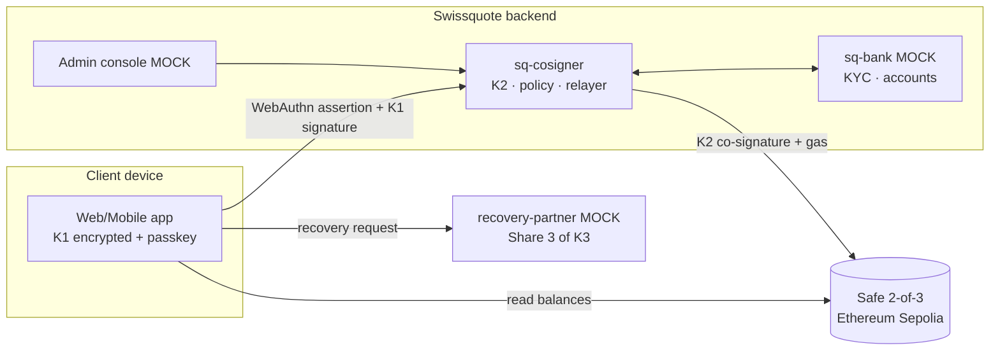

# BRIEF POUR L'AGENT CLAUDE CODE — "SQ Wallet" (Swissquote Wallet Challenge, EPFL Hackathon, oct. 2026)

> Tu es l'agent de développement unique de ce projet. La porteuse du projet (Noa) **ne sait pas coder** et ne sera pas devant l'écran.
> Tu dois livrer un prototype qui fonctionne de bout en bout, de façon autonome.
> Lis ce document en entier avant d'écrire la moindre ligne de code.
> Langue : écris le code, le README et la doc en **anglais** (jury). Écris les messages destinés à Noa en **français**.

---

## 0. Protocole de travail autonome (À RESPECTER EN PRIORITÉ)

### 0.1 Quand tu as besoin d'un humain
Certaines actions ne peuvent être faites que par Noa : alimenter une adresse via un faucet, tester Touch ID dans le navigateur, créer un compte sur un service externe, etc. Dans ce cas :

1. **Ajoute une entrée** dans le fichier `POUR_NOA.md` à la racine du repo, au format exact suivant :

```
## [BLOQUANT | NON BLOQUANT] <titre court> — <heure>
**Ce que j'ai besoin que tu fasses :** <1 phrase simple>
**Étapes exactes :**
1. ...
2. ...
**Comment me répondre :** <ce que Noa doit taper/coller dans le terminal Claude Code>
**Si tu bloques, copie-colle ce prompt à Claude (dans le chat) :**
> Je fais un hackathon, mon agent Claude Code me demande : <reformulation complète, autonome, avec le contexte et les messages d'erreur>. Explique-moi pas à pas comme à une débutante sur Mac.
```

2. **Affiche aussi ce message dans le terminal**, bien visible :
   `📩 MESSAGE POUR NOA — voir POUR_NOA.md`
3. Si c'est **NON BLOQUANT** : continue les autres tâches pendant ce temps.
   Si c'est **BLOQUANT** : termine tout ce qui peut avancer sans cette action, puis attends.
4. Ne demande **jamais** à Noa de lire ou de modifier du code. Ne lui demande **jamais** de coller une clé privée ou un token dans le chat.
5. Dès le départ, regroupe dans un seul message toutes les actions humaines prévisibles (voir §9), plutôt que de les demander une par une.

### 0.2 Discipline
- Commence par un **plan écrit** dans `docs/PLAN.md` : jalons, ordre, risques. Mets-le à jour à chaque jalon atteint, avec une case à cocher.
- Fais un **commit git à chaque jalon** qui fonctionne. Messages clairs, en anglais. Fais un `git push` si le remote est configuré. S'il demande une authentification, c'est une entrée NON BLOQUANTE pour Noa.
- **Ne commite jamais de secrets.** `.env` et les dossiers `data/` des services vont dans `.gitignore`. Fournis un `.env.example`.
- Avant d'utiliser une bibliothèque (Safe protocol-kit, SimpleWebAuthn, etc.), **vérifie son API actuelle** dans sa doc officielle ou son README sur npm. Ne te fie pas à ta mémoire : les API de Safe ont changé entre les versions majeures.
- **Interdiction d'implémenter de la cryptographie soi-même** (règle du jury, pénalisée). N'utilise que des bibliothèques établies : `ethers` v6 ou `viem`, `@safe-global/protocol-kit`, `@simplewebauthn/browser` et `@simplewebauthn/server`, `shamir-secret-sharing` (Privy, audité).
- **Évite les modules natifs** (ex. `better-sqlite3`) : la machine est un Mac Apple Silicon avec Node 26, et les builds natifs risquent d'échouer. Stocke les données en **fichiers JSON par service**.
- **Priorité absolue** : le parcours **create → sign → recover** doit marcher de bout en bout sur Sepolia **avant** tout bonus ou tout polissage visuel. Les bonus ne rapportent rien si ce parcours ne marche pas.
- Chaque fonctionnalité simulée (mock) porte un **badge visible « MOCK »** dans l'interface et apparaît dans le tableau Real vs Mock du README.

---

## 1. Le challenge (résumé du cahier des charges officiel)

Construire le wallet en **self-custody** que Swissquote pourrait lancer : le client garde le contrôle de ses clés, avec la sécurité, la simplicité et la conformité d'une banque suisse, à un clic de son compte Swissquote.

**Obligatoire :**
- Une démo en une histoire continue : **créer le wallet → s'authentifier et signer une transaction → perdre l'appareil ou la clé → récupérer l'accès**.
- Au moins une transaction **réellement signée et envoyée** sur une blockchain (testnet accepté).
- Six sujets à couvrir : modèle de garde (custody) + modèle de menaces, architecture (réel vs mock), création du wallet, authentification (petite vs grosse transaction), récupération (y compris **si Swissquote disparaît définitivement**), business case.
- **Un détenteur de part simulé doit tourner comme un processus séparé avec son propre stockage, et l'app client ne doit jamais détenir sa part.**
- Pas de crypto maison. Les mocks sont acceptés s'ils sont annoncés honnêtement.

**Bonus (jusqu'à +20 pts, comptés seulement si le parcours obligatoire marche) :**
- **Gasless** : envoyer de l'USDC sans posséder d'ETH. Expliquer qui paie et comment on évite les abus.
- **Interaction dApp conforme** : liste blanche de dApps, filtrage sanctions, simulation de la transaction en langage clair, contrôles renforcés au-dessus d'un seuil.
- Une récupération qui **refuse un attaquant ayant volé le téléphone ET l'email**.

**Barème :** technique 35, sécurité/custody 20, faisabilité légale 15, business 15, UX/pitch 15, bonus +20.

**Le README doit couvrir :** modèle de garde et de menaces, diagramme d'architecture (mocks marqués), custody et Travel Rule, modèle économique, bonus réalisés, **outils IA utilisés et pour quoi faire** (Claude Code pour le développement, Claude pour la conception).

---

## 2. Décisions de design (version clarifiée et consolidée du plan de Noa)

Ce qui suit reprend les idées de Noa, triées, rendues cohérentes entre elles et rattachées au cahier des charges. Les points marqués ⚠️ sont des idées d'origine modifiées pour des raisons de sécurité ou de droit. Explique-les ainsi dans la doc.

### 2.1 Modèle de garde : smart account Safe, 2 signatures sur 3, Swissquote co-signataire
Le wallet est un **Safe (smart account) sur Ethereum Sepolia**, avec **3 propriétaires et un seuil de 2** :

| Clé | Qui la détient | Où elle vit | Rôle |
|---|---|---|---|
| **K1 – Device key** | Client | Générée **dans le navigateur ou l'app** du client, chiffrée localement (mot de passe) et utilisable seulement après une **passkey biométrique** (Touch ID / Face ID) | Signature quotidienne |
| **K2 – Swissquote co-signer** | Swissquote | Générée **côté serveur** dans le service `sq-cosigner` (en production : HSM). **Jamais** dans le client | Co-signe **après** les contrôles : authentification, conformité, limites |
| **K3 – Recovery key** | Client | Générée chez le client à la création, puis **découpée en 3 parts Shamir (2 sur 3)** : ① kit papier (QR à imprimer), ② sauvegarde cloud chiffrée du client (mock : fichier téléchargé), ③ **partenaire de récupération indépendant** (service `recovery-partner`, ex. notaire ou trustee suisse). La clé entière est effacée de la mémoire après le découpage | Récupération et porte de sortie |

**Usage normal** = K1 + K2 : le client signe, Swissquote co-signe. Cela reprend l'idée de Noa : « le client ET Swissquote signent pour que l'opération soit valide au niveau blockchain ».

**Pourquoi ce modèle (à défendre dans la doc) :**
- **Swissquote ne peut pas bouger les fonds seul** : il n'a qu'une clé sur trois. C'est donc plus proche d'un logiciel que d'une garde (custody), ce qui est l'argument légal clé (§6).
- **Swissquote + le partenaire ne peuvent pas non plus** bouger les fonds sans le client : le partenaire ne détient qu'une part sur trois de K3, ce qui ne suffit pas à la reconstituer. La « zone grise » soulevée par le sujet est donc fermée.
- **Si Swissquote disparaît**, le client reconstitue K3 (papier + cloud) et signe avec K1 + K3. Ses fonds restent accessibles sans Swissquote. C'est la **porte de sortie (escape hatch)**, à démontrer.
- Safe est le standard des smart accounts (des milliards de dollars sécurisés, contrats audités). Le seuil 2 sur 3 est appliqué **on-chain** : ce n'est pas une promesse de Swissquote.
- Limite assumée : EVM uniquement, donc pas de Bitcoin. Évolution proposée : du MPC/TSS pour le BTC (à mentionner, pas à construire).

⚠️ **Modification de l'idée « au-dessus d'un certain montant, une autre personne chez Swissquote signe aussi on-chain »** : si Swissquote détenait deux clés sur trois, il pourrait bouger les fonds seul, ce qui en ferait de la garde au sens bancaire. On garde l'idée, mais **hors chaîne** : au-dessus du seuil, le co-signataire K2 n'accepte de signer qu'après une **validation à quatre yeux** par un agent conformité Swissquote, faite dans la console admin (mock). Swissquote garde une seule clé on-chain.

### 2.2 Création du wallet (onboarding)
1. Le client est déjà **client Swissquote, KYC fait** (mock `sq-bank` : compte « Alice Muster » avec sa pièce d'identité et une photo de référence pour la vérification de vivacité, ou liveness).
2. Il ouvre l'**onglet « Wallet » intégré à l'app Swissquote** (l'idée de « languette intégrée » de Noa) et se connecte avec son identifiant Swissquote (mock).
3. Il crée sa **passkey** (WebAuthn, Touch ID) : c'est la **liaison à l'appareil (device binding)**. Il définit un **mot de passe wallet** qui chiffre K1 localement (format keystore JSON d'ethers, scrypt).
4. Le navigateur génère K1 et K3 et découpe K3 en 3 parts. La part ③ part au `recovery-partner` avec l'identité KYC, la part ① s'affiche en QR (**« Imprimez votre kit de récupération »**), la part ② est téléchargée comme « sauvegarde cloud » (mock iCloud).
5. `sq-cosigner` génère K2 côté serveur et renvoie son adresse.
6. Le **relayer Swissquote déploie le Safe** (owners K1, K2, K3 ; seuil 2). C'est **gasless** pour le client.
7. Le Safe est **enregistré comme wallet vérifié du client** chez Swissquote, avec une preuve de possession signée (EIP-1271). La vérification Travel Rule est donc automatique (§6).
8. Vue d'ensemble : solde, actifs, activité. Un clic sur une devise ouvre son écran (transactions, état du compte).

**Limite d'appareils (idée de Noa)** : au maximum **1 mobile + 1 ordinateur** enregistrés par client, appliqué par `sq-cosigner` qui refuse une 3e passkey. Pour **changer d'appareil**, il faut l'appareil existant (approbation par passkey) + le mot de passe + un code OTP par email (mock) + une confirmation par SMS (mock). Sinon, on passe par la procédure de récupération complète (§2.4).

### 2.3 Authentification et signature (idée de Noa : « biométrie à chaque transaction puis confirmation par la clé »)
Toute action sensible (envoi, échange, approbation de dApp, changement de réglage) demande une **signature**. La **signature est toujours faite localement** sur l'appareil, puis validée par le co-signataire.

| Niveau | Condition (démo) | Exigences |
|---|---|---|
| **Standard** | < 50 USDC (en prod : < 1 000 CHF) et destinataire connu | Mot de passe déjà débloqué en session + **passkey biométrique** (assertion WebAuthn vérifiée par `sq-cosigner`) → K1 signe → K2 co-signe automatiquement après les contrôles |
| **Renforcé (step-up)** | ≥ 50 USDC **ou** nouveau destinataire **ou** interaction avec une dApp | Passkey **+ OTP email (mock)** + **délai de réflexion** (démo 30 s, prod 24 h pour un nouveau destinataire) + **validation à quatre yeux** par un agent conformité Swissquote dans la console admin |

Les trois « sas de sécurité » de Noa (mot de passe, biométrie, SMS ou email) sont conservés, mais pondérés :
- mot de passe = déverrouillage local ;
- biométrie/passkey = facteur principal ;
- SMS/email = **notification et facteur secondaire uniquement**, car le SMS est vulnérable au SIM swap et l'email peut être compromis. **Ni l'un ni l'autre ne suffit jamais seul.**

**Avant chaque transaction**, le client **et** `sq-cosigner` vérifient la **disponibilité des fonds on-chain** (solde réel lu sur Sepolia), comme demandé par Noa.

### 2.4 Récupération (le cœur des points sécurité)
**Scénario A — téléphone perdu ou volé (récupération normale) :**
1. Sur un nouvel appareil, le client lance « J'ai perdu mon appareil ».
2. **Vérification d'identité forte** auprès du `recovery-partner` et de Swissquote : connexion au compte Swissquote, **selfie de vivacité comparé au KYC** (mock avec un bouton « réussir / échouer »), **3 questions de récupération** (l'idée de Noa, gardée mais ⚠️ avec un **poids faible** dans le score de risque : une question est devinable ou se trouve par ingénierie sociale, donc jamais suffisante seule).
3. Le client scanne son **kit papier** (part ①). Le partenaire libère la part ③ après vérification. Le navigateur reconstitue K3.
4. Une **demande de rotation** est créée : `swapOwner(ancienne K1 → nouvelle K1)`. C'est la **révocation de l'ancien signataire**, conformément au scénario de Noa : on vérifie d'abord les owners et le seuil actuels, puis on met à jour la configuration.
5. **Délai de sécurité** (démo 2 min, prod 48 h). Pendant ce délai, des **notifications** partent partout (email, SMS, compte Swissquote) avec un bouton **« Ce n'est pas moi → annuler »**.
6. À la fin du délai, sans annulation, K3 + K2 signent le `swapOwner`. L'ancien téléphone est **révoqué on-chain**.

**Scénario B — l'attaquant a volé le téléphone ET l'email (démo bonus, doit être REFUSÉ) :**
- Il n'a pas la biométrie : la passkey échoue et K2 refuse de co-signer les transactions.
- S'il lance une récupération : la **liveness échoue** (le visage ne correspond pas au KYC) ; il **n'a pas le kit papier** (la part cloud ne suffit pas, il faut 2 parts sur 3) ; le **score de risque** est élevé (nouvel appareil, IP inhabituelle, SIM swap récent simulé) ; le **vrai client est notifié** sur son compte Swissquote, protégé par une autre authentification, et peut annuler.
- La démo affiche un **écran de refus** qui explique quel contrôle a bloqué l'attaquant. La console admin enregistre la tentative.

**Scénario C — Swissquote disparaît définitivement (porte de sortie) :**
- Le client reconstitue K3 (papier + cloud, sans partenaire ni Swissquote) et signe avec **K1 + K3**. Les fonds sont transférés vers n'importe quelle adresse.
- Fournis un script `npm run escape-hatch` **et** explique que l'interface publique Safe (app.safe.global, compatible Sepolia) fonctionne aussi. **À démontrer avec une vraie transaction.**
- Cas extrême documenté (pas à construire) : appareil perdu ET Swissquote disparu. En production, un **module de délai Zodiac** permettrait à K3 seule de faire la rotation des owners après 30 jours.

### 2.5 Conformité et dApps (bonus)
Le **moteur de règles (policy engine)** est dans `sq-cosigner`. K2 ne co-signe que si toutes les règles passent :
- **Filtrage sanctions** : liste d'adresses bloquées (mock d'une liste de type OFAC/SECO, avec au moins une adresse de démo bloquée). Refus avec un message clair.
- **Liste blanche de dApps** : contrats approuvés (ex. une adresse de démo « Uniswap (Sepolia) » ou un contrat de test). Une dApp hors liste est refusée, ou passe en step-up selon le réglage.
- **Simulation avant signature** : `eth_call` / `simulate` de la transaction Safe, puis décodage (transfert ERC-20, `approve`…) en **langage clair** : « Vous allez envoyer 10 USDC à 0xAB…12 (contact : Bob). Frais : 0 CHF (offerts par Swissquote). Solde après : 90 USDC. » Alerte rouge en cas d'`approve` illimité.
- **Seuils** pour les gros montants (§2.3), plus des **limites par jour**.
- **Carnet d'adresses** avec vérification de propriété pour les wallets externes du client (signature d'un message).

### 2.6 Gasless (bonus)
- Le **relayer Swissquote** (un compte EOA, dans `sq-cosigner`, financé en ETH Sepolia) soumet `execTransaction` du Safe et **paie le gas**. Le client n'a jamais besoin d'ETH.
- Démo : **envoi d'USDC** (USDC Circle sur Sepolia, `0x1c7D4B196Cb0C7B01d743Fbc6116a902379C7238`, à vérifier sur developers.circle.com) depuis un Safe qui n'a **aucun ETH**.
- **Anti-abus** : réservé aux wallets liés à un client KYC, quota de transactions sponsorisées par jour et par client, plafond de gas, transaction sponsorisée seulement si le moteur de règles l'accepte. **Qui paie ?** Swissquote, comme coût d'acquisition et de rétention, inclus dans l'abonnement (§7).
- Production (à documenter seulement) : ERC-4337 avec un paymaster (Pimlico ou Coinbase) ou EIP-7702.

### 2.7 Lien avec le compte Swissquote et transparence
- **Virements compte Swissquote ↔ wallet** en un clic (mock `sq-bank` : solde CHF/USDC fictif). Le wallet est **pré-vérifié**, donc aucune friction Travel Rule. C'est le « lien avec les banques traditionnelles » de Noa.
- **Espace d'activité partagé** (idée de Noa) : un fil d'activité côté client (tout ce qui s'est passé, qui a signé, quels contrôles) + le même journal côté **console admin Swissquote**. Notifications par email en mock (affichées dans une boîte « Mock Inbox »).
- **Réglage de confidentialité** (idée de Noa : « le client choisit la vue que Swissquote a sur ses actifs ») : « Vue consolidée complète » / « Solde uniquement » / « Aucune ». Précise honnêtement dans la doc que la blockchain est publique ; ce réglage contrôle l'affichage consolidé et l'usage des données par Swissquote, pas la visibilité on-chain.

---

## 3. Architecture technique

### 3.1 Composants (chaque service = un processus séparé + son propre dossier `data/`)

```
apps/web                 Client app (Vite + React + TypeScript + Tailwind). Mobile-first responsive.
                         Holds: K1 (encrypted), temporary K3 during creation/recovery only.
                         Routes: /onboarding /wallet /asset/:symbol /send /activity /settings /recover
                                 /admin (Swissquote back-office console — clearly labeled MOCK)
                                 /attacker (scripted attacker demo)
services/sq-cosigner     Express + TS, port 4001, data/ = JSON. Holds K2 + relayer key.
                         WebAuthn registration/verification, policy engine, simulation, step-up,
                         four-eyes approvals, recovery delay & cancel, gas sponsoring (relayer),
                         Safe deployment, activity log.
services/recovery-partner Express + TS, port 4002, data/ = JSON. Holds share ③ of K3 ONLY.
                         Releases it only after identity check (mock liveness + questions + risk score).
services/sq-bank         Express + TS, port 4003, data/ = JSON. MOCK Swissquote core banking + KYC:
                         client profile, CHF/USDC account, transfer to/from wallet, verified-wallet registry.
packages/shared          Shared types, constants (chain id, USDC address, thresholds), ABI fragments.
scripts/                 e2e-demo.ts (headless create→sign→recover on Sepolia), escape-hatch.ts,
                         fund-check.ts, reset-demo.ts
```

Une seule commande lance tout : `npm run dev` (via `concurrently`). Le README explique comment ouvrir la démo.

### 3.2 Diagramme (à reproduire en Mermaid dans le README, mocks marqués)



### 3.3 Flux de signature (référence)
1. L'app construit la `SafeTransaction` (protocol-kit) → affiche la **simulation en langage clair**.
2. L'utilisateur valide avec Touch ID (assertion WebAuthn sur un challenge = hash de la SafeTx) → K1 signe le hash (EIP-712).
3. `POST sq-cosigner /tx/cosign` avec { safeTx, sigK1, webauthnAssertion }.
4. Le co-signataire vérifie l'assertion, les fonds disponibles, les règles et le niveau (standard ou step-up).
5. Si tout passe, K2 signe et le relayer exécute `execTransaction` (gas payé par Swissquote) → renvoie le hash de la transaction.
6. L'app affiche **« Confirmée »** avec un lien Etherscan Sepolia. L'événement est journalisé des deux côtés.

### 3.4 Réel vs Mock (à mettre tel quel dans le README et à maintenir)

| Élément | Statut |
|---|---|
| Safe 2-of-3 on Sepolia, signatures, execution, owner rotation | **REAL** |
| USDC transfers (Circle Sepolia USDC), gas sponsoring by relayer | **REAL** |
| Passkeys / WebAuthn (Touch ID) | **REAL** (browser) |
| Shamir split of K3 (`shamir-secret-sharing`) | **REAL** library |
| Policy engine, simulation (eth_call), thresholds, delays | **REAL** logic (demo values) |
| Swissquote core banking, KYC, client account | **MOCK** |
| Liveness / video-ident, SMS, email | **MOCK** |
| Sanctions list provider (Chainalysis/Elliptic in prod) | **MOCK** list |
| Recovery partner (independent Swiss trustee) | **MOCK** service, separate process |
| HSM for K2 (in prod) | **MOCK** = JSON file |

---

## 4. Jalons (dans cet ordre ; ne passe au suivant que quand le précédent est vérifié)

**M0 — Mise en place (≤ 30 min)**
Monorepo npm workspaces, TypeScript, `.gitignore`, `.env.example`, `npm run dev`. Génère les clés de service (K2, relayer) au premier lancement et **affiche l'adresse du relayer** → **message POUR_NOA (BLOQUANT pour M2)** : l'alimenter en ETH Sepolia via le faucet. Écris `docs/PLAN.md`.
*Contexte :* le repo contient peut-être déjà des scripts de test de Noa (`create-wallet.js`, `send-tx.js`). Déplace-les dans `scripts/legacy/` sans les supprimer.

**M1 — Chemin critique en script (headless)**
`scripts/e2e-demo.ts` : génère K1/K3 (logiciel), K2 via l'API du co-signataire → déploie le Safe 2-of-3 via le relayer → envoie une transaction K1+K2 → simule la perte de K1 → reconstitue K3 depuis 2 parts → `swapOwner` K3+K2 → nouvelle transaction avec la nouvelle K1. **Tout est réel sur Sepolia.** Affiche les liens Etherscan.
✅ *Critère :* le script passe de bout en bout. **Commite immédiatement.** C'est notre filet de sécurité si l'interface ne marche pas pendant la démo.

**M2 — Services séparés + règles**
`sq-cosigner` (cosign, deploy, relayer, règles de base, journal), `recovery-partner` (stockage et libération de la part ③), `sq-bank` (client mock, wallets vérifiés). Tests unitaires du moteur de règles (sanctions, seuil, liste blanche).

**M3 — App web : onboarding + passkey + vue d'ensemble**
Création de la passkey (SimpleWebAuthn), mot de passe, génération des clés, kit de récupération (QR + téléchargement), déploiement du Safe, vue d'ensemble avec les soldes réels ETH/USDC (et leur valeur en CHF au taux mock).
→ **POUR_NOA (NON BLOQUANT)** : récupérer de l'USDC de test sur faucet.circle.com (réseau Ethereum Sepolia) pour l'adresse du Safe, et tester Touch ID dans Chrome.

**M4 — Envoi avec simulation + step-up + gasless**
Écran d'envoi, simulation en langage clair, Touch ID, co-signature, exécution sponsorisée, reçu avec lien Etherscan. Au-dessus du seuil : OTP mock + délai + validation dans `/admin`.

**M5 — Récupération (scénarios A, B, C)**
Flux « J'ai perdu mon appareil », délai avec bouton d'annulation, rotation on-chain ; page `/attacker` qui joue le scénario B et montre le refus ; `npm run escape-hatch` pour le scénario C.

**M6 — Conformité dApp**
Liste blanche, filtrage sanctions (refus visible), simulation d'un `approve` avec alerte, journal côté admin.

**M7 — Finition UX + doc + pitch**
Polissage visuel (§5), README complet (§8), `docs/DEMO_SCRIPT.md`, `npm run reset-demo` pour rejouer la démo proprement.

**M8 (optionnel)** — Réglage de confidentialité, vérification de propriété d'un wallet externe, internationalisation FR/EN.

---

## 5. UX : « l'ergonomie maximale, au standing d'une banque suisse »
- Style **sobre et premium** : fond blanc ou gris très clair, un bleu nuit comme couleur principale, beaucoup d'espace, typographie nette (Inter ou équivalent), chiffres alignés, **montants en CHF en premier**, crypto en second. Pas de jargon : « clé de récupération » plutôt que « K3 », « frais offerts par Swissquote » plutôt que « paymaster ».
- **N'utilise pas le vrai logo ni les marques déposées de Swissquote.** Nom du prototype : **« SQ Wallet — prototype »**, avec un badge « Hackathon prototype » discret.
- Mobile d'abord (la démo peut se faire en vue mobile dans Chrome DevTools). Navigation par onglets en bas : Wallet · Send · Activity · Settings.
- Chaque étape sensible affiche **pourquoi** on demande quelque chose (« Nous vérifions que c'est bien vous : touchez le capteur »).
- Les états de chargement donnent du sens (« Signature… », « Contrôles de conformité… », « Envoi sur Ethereum… »). Écran de succès avec le lien Etherscan.
- Les écrans d'erreur et de refus sont humains et expliquent quoi faire.
- Badge **MOCK** visible sur chaque élément simulé.

---

## 6. Légal (à rédiger dans `docs/LEGAL.md` ; pas un avis juridique, mention à inclure)
- **Custody** : selon la logique FINMA, la question est de savoir qui peut bouger les fonds. Ici, Swissquote détient **1 clé sur 3** et ne peut **rien faire seul**. Avec le partenaire de récupération, il ne peut pas non plus, puisque le partenaire n'a qu'une part de K3 sur trois. → Argumenter que c'est un **wallet non-custodial (logiciel + service de co-signature)**, sans dépôt crypto au bilan, avec des exigences de capital et de ségrégation réduites. Assumer la **zone grise** : Swissquote peut **bloquer** (refuser de co-signer), sans pouvoir **bouger** les fonds. Atténuation : porte de sortie K1+K3 et engagement contractuel. Signaler les risques résiduels, par exemple une contrainte légale imposée à la fois au partenaire et au fournisseur cloud du client ; atténuation : la part cloud est chiffrée par le mot de passe du client.
- **Travel Rule / wallets auto-hébergés** : la FINMA impose de vérifier la propriété d'un wallet externe avant d'y envoyer ou d'en recevoir des cryptos (voir FINMA Guidance 02/2019 ; référence à revérifier). Ici, le Safe est **créé par Swissquote pour un client déjà KYC**, avec la preuve de possession (signature EIP-1271) enregistrée à la création. La vérification est donc **automatique et cryptographique**, sans « test Satoshi » manuel. Pour les wallets externes du client : vérification par signature de message dans le carnet d'adresses.
- **Paiement à un tiers depuis le wallet** : Swissquote n'exécute pas l'ordre pour le compte du client ; il ne fait que co-signer techniquement, sans pouvoir agir seul. On peut donc défendre qu'il **n'est pas l'institution émettrice** au sens de la Travel Rule. Présenter la position contraire de façon honnête : il co-signe et filtre, donc il pourrait être considéré comme intermédiaire. Option prudente intégrée au produit : collecte facultative des infos bénéficiaire pour les gros montants.
- **LBA / AML** : le filtrage sanctions et les seuils renforcés montrent une approche fondée sur les risques.
- Termine par une section « Questions ouvertes pour un juriste ».

---

## 7. Business case (dans `docs/BUSINESS.md` + section README ; chiffres = hypothèses marquées)
- **Problème actuel** : chaque retrait vers un wallet externe = des actifs qui **quittent l'écosystème** Swissquote, avec des coûts de conformité (vérification manuelle des wallets externes).
- **Revenus** (idée de Noa : abonnement, enrichie) :
  - **Gratuit** : wallet, sauvegarde, limites standard ;
  - **Premium ~5 CHF/mois** : limites élevées, frais de gas offerts, récupération prioritaire avec un humain, transmission successorale (désignation d'héritiers via la récupération) ;
  - **commissions** sur les échanges et virements wallet ↔ compte (spread) ;
  - accès à des dApps sélectionnées (frais de distribution).
- **Rétention** : les actifs restent **à un clic** du compte de trading, donc les clients reviennent trader chez Swissquote au lieu de partir sur un exchange.
- **Nouveaux clients** : clients crypto natifs qui veulent la self-custody et la sécurité d'une banque suisse. C'est un différenciateur face aux néobanques et aux exchanges.
- **Baisse des coûts** : vérification Travel Rule automatisée, moins de tickets de support (récupération guidée), pas de capital à immobiliser pour de la garde.
- Fournis un **petit calcul illustratif** (ex. 5 % de 600 000 clients × 5 CHF × 12 mois) en précisant que ce sont des hypothèses.

---

## 8. Livrables finaux
- `README.md` : pitch en 3 lignes, quick start (`npm install`, `npm run dev`), diagramme, tableau Réel vs Mock, modèle de garde et de menaces (§9.2), récap légal, business, bonus réalisés, outils IA utilisés.
- `docs/THREAT_MODEL.md`, `docs/LEGAL.md`, `docs/BUSINESS.md`, `docs/DEMO_SCRIPT.md` (démo de 3 min, voir ci-dessous), `docs/PLAN.md`.
- `POUR_NOA.md` à jour, avec une dernière entrée **« Comment lancer la démo »** en 5 étapes simples.

**Scénario de démo (à écrire dans DEMO_SCRIPT.md) :**
1. Alice, cliente Swissquote, ouvre l'onglet Wallet → passkey → wallet créé → kit de récupération (30 s).
2. Elle reçoit de l'USDC depuis son compte Swissquote (wallet pré-vérifié pour la Travel Rule).
3. Elle envoie 10 USDC à Bob : simulation claire → Touch ID → **sans ETH, frais offerts** → lien Etherscan.
4. Elle tente 500 USDC → step-up → validation dans la console admin.
5. Elle tente une adresse sanctionnée → refus expliqué.
6. Elle perd son téléphone → récupération → délai → ancienne clé révoquée on-chain → nouvelle transaction.
7. Un voleur avec son téléphone et son email essaie → **refusé** (écran explicatif).
8. « Et si Swissquote disparaît ? » → `escape-hatch` : fonds déplacés avec K1+K3, sans Swissquote.
9. Business case en une diapo.

---

## 9. Annexes

### 9.1 Actions humaines prévisibles (à regrouper dans UN message POUR_NOA dès M0)
1. Alimenter l'**adresse du relayer** en ETH Sepolia : https://cloud.google.com/application/web3/faucet/ethereum/sepolia (prévoir une solution de repli : demander aux mentors du hackathon).
2. Plus tard, récupérer de l'**USDC Sepolia** sur https://faucet.circle.com pour l'adresse du Safe de démo.
3. Tester **Touch ID** dans Chrome sur `http://localhost:5173` (WebAuthn fonctionne sur localhost).
4. Lancer `git push` si une authentification est demandée.
Utilise le RPC public `https://ethereum-sepolia-rpc.publicnode.com` (avec un second RPC public en secours) pour **éviter de demander une clé API**.

### 9.2 Modèle de menaces (base à développer dans THREAT_MODEL.md)

| Menace | Peut voler ? | Peut bloquer ? | Contre-mesure |
|---|---|---|---|
| Voleur du téléphone | Non (pas de biométrie, K1 chiffrée, K2 refuse) | Non | Passkey, mot de passe, rotation via récupération |
| Téléphone + email compromis | Non | Non | Liveness, kit papier requis (2 parts sur 3), délai + annulation, score de risque |
| SIM swap | Non | Non | SMS jamais suffisant seul |
| Swissquote seul (ou employé malveillant) | **Non** (1 sur 3) | Oui (refus de co-signer) | Porte de sortie K1+K3, quatre yeux, journal |
| Swissquote + partenaire | **Non** (1 part de K3 sur 3) | — | Parts réparties |
| Serveur Swissquote piraté (K2 volée) | Non seul ; il faudrait aussi K1 ou K3 | Possible | HSM en prod, rotation de K2 via K1+K3 |
| Client qui perd tout (appareil + papier + cloud) | — | Oui (perte) | Partenaire + liveness, conseil : 2 copies papier |
| Swissquote disparaît | — | Non | Porte de sortie K1+K3, UI Safe publique |
| Phishing / dApp malveillante | Réduit | — | Liste blanche, simulation, alerte `approve` |

### 9.3 Paramètres de démo
Chaîne : Ethereum Sepolia (chainId 11155111). Seuil de step-up : 50 USDC. Délai de récupération : 2 min. Délai de réflexion pour un nouveau destinataire : 30 s. Quota gasless : 20 transactions par jour et par client. Taux mock : 1 USDC = 0,88 CHF (affiché « indicatif »).

---

**Commence maintenant par :** (1) lire le repo existant, (2) écrire `docs/PLAN.md`, (3) M0, (4) le message groupé POUR_NOA, (5) M1. Bon travail.
