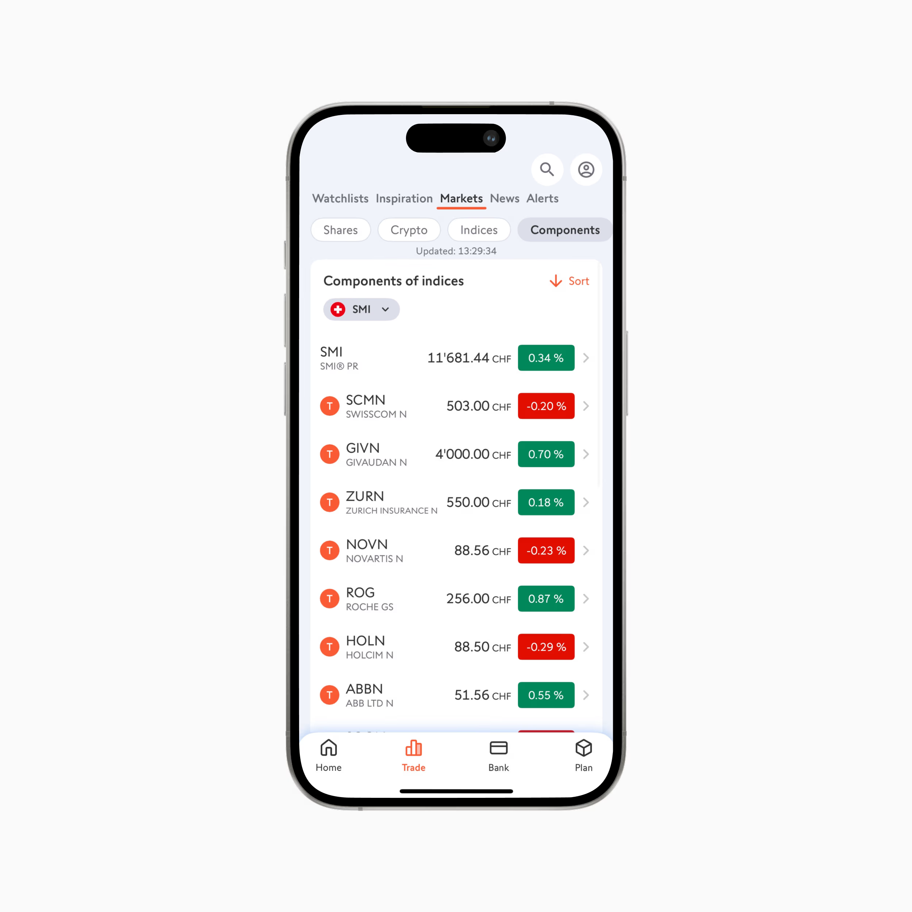
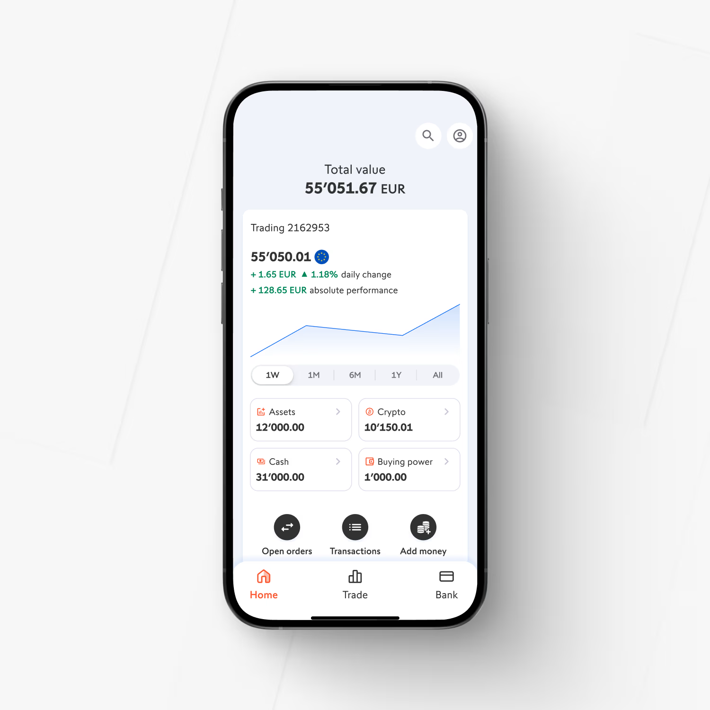

# MY WALL — Spécification de refonte visuelle et fonctionnelle (pour l'agent Claude Code)

> **À l'agent :** ce document **complète** `CLAUDE_CODE_BRIEF.md`, il ne le remplace pas. L'architecture (Safe 2-sur-3, co-signataire, partenaire de récupération, relayer, Sepolia) et le protocole `POUR_NOA.md` restent valables.
>
> Ce document **remplace** trois règles de `CLAUDE_CODE_BRIEF.md` :
> - §5, « ne pas utiliser le logo Swissquote » : on utilise désormais le **logo fourni** ;
> - le nom « SQ Wallet » devient **« My Wall »** ;
> - la langue de l'interface passe de l'anglais au **français**. Le README et les docs restent en anglais.
>
> Le parcours **create → sign → recover** doit continuer de fonctionner à chaque étape. Après chaque jalon, lance `npm run typecheck`, `npm test` et `npm run e2e`, puis commite. Si un test casse, répare-le avant de continuer.

---

## 0. Références visuelles (priorité absolue pour la direction artistique)

Les fichiers sont dans `docs/design/assets/`. Une copie du logo est dans `apps/web/public/brand/`.

**Référence A1 — Swissquote, page Marchés**


**Référence A2 — Swissquote, page Accueil**


**Référence B — logo fourni**


**À reprendre de ces captures :**
- fond gris très clair et froid ;
- cartes blanches légèrement arrondies ;
- texte anthracite ;
- accents orange ;
- onglet actif **souligné en orange** ;
- filtres en capsules à bordure fine (capsule active : fond gris) ;
- badges de variation **rectangulaires**, verts ou rouges, avec texte blanc ;
- chevrons gris discrets à droite des lignes ;
- icônes au **trait** ;
- navigation du bas sobre, avec l'item actif en orange ;
- boutons ronds sombres pour les actions rapides (« Open orders », « Transactions », « Add money ») ;
- tuiles d'informations à bordure fine (Assets, Crypto, Cash, Buying power) ;
- graphique en ligne bleue fine avec un dégradé très léger.

**Logo :** utiliser le PNG fourni tel quel. Ne pas le redessiner, ne pas changer ses proportions, ne pas ajouter d'ombre ni d'effet. Garder une marge d'au moins 25 % de son diamètre autour. Tailles : 28 px dans les barres de navigation, 56 px sur les écrans d'accueil et de déverrouillage, et aussi en favicon.

**Mention obligatoire et discrète** (pied de l'interface reconstituée et du wallet) : « Prototype — Swissquote Wallet Challenge (EPFL). Reconstitution de démonstration, données fictives. »

---

## 1. Vision et périmètre de la démo

L'utilisateur démarre dans une **reconstitution de l'app Swissquote** (données de marché fictives). Il ouvre **My Wall** depuis :
- une **languette « Mon wallet »** en bas sur mobile ;
- un **bouton « Mon wallet »** à côté de l'icône de compte sur ordinateur.

Il se retrouve alors dans un wallet qui prolonge le même univers graphique, sans rupture. Toutes les fonctions existantes restent disponibles : envoi, réception, transferts depuis le compte, dApps, step-up, console admin, page attaquant, récupération et porte de sortie.

On ajoute :
- vérification d'identité simulée ;
- mot de passe de 15 caractères ;
- 3 questions choisies parmi 15 ;
- gestion des clés **sans QR code** ;
- confirmation animée des transactions ;
- justificatifs PDF ;
- espace **Swaplet → Documents** ;
- section **Informations** en 3 catégories ;
- mises en page **mobile, tablette et ordinateur** distinctes.

---

## 2. Système visuel (tokens)

Remplace les tokens « navy » de `apps/web/src/index.css`. Couleurs relevées par échantillonnage des captures ; ajuste-les à l'œil en comparant tes captures d'écran aux références.

```css
@theme {
  --font-sans: "Inter", ui-sans-serif, system-ui, -apple-system, sans-serif;
  --color-sq-orange: #FA5B35;      /* logo, CTA, onglet actif, item nav actif */
  --color-sq-orange-600: #E64A25;  /* survol / pressé */
  --color-sq-orange-50: #FFF1EC;   /* fonds doux d'accent (rare) */
  --color-sq-bg: #F0F3FA;          /* fond d'écran */
  --color-sq-surface: #FFFFFF;     /* cartes, nav */
  --color-sq-ink: #303137;         /* texte principal */
  --color-sq-ink-2: #4E4E4E;       /* texte courant */
  --color-sq-muted: #7A7F8A;       /* texte secondaire, chevrons */
  --color-sq-line: #E3E6EE;        /* bordures fines, séparateurs */
  --color-sq-chip: #E2E5EE;        /* capsule de filtre active */
  --color-sq-up: #00875A;          /* variation positive (toujours avec « + » ou ▲) */
  --color-sq-down: #E20E00;        /* variation négative (toujours avec « − » ou ▼) */
  --color-sq-chart: #2F6FED;       /* ligne de graphique */
  --color-sq-dark: #2B2D33;        /* boutons ronds d'action rapide */
  --radius-card: 12px;  --radius-tile: 10px;  --radius-btn: 10px;
  --radius-badge: 4px;  --radius-pill: 999px;
}
```

- **Police** : Inter installée en local (`@fontsource/inter`, graisses 400/500/600), pour ne pas dépendre du wifi pendant la démo. Chiffres tabulaires (`font-variant-numeric: tabular-nums`). Séparateur de milliers suisse : **apostrophe** (`55'051.67`), via `Intl.NumberFormat('de-CH')`.
- **Hiérarchie des montants** : le montant en gras et grand, la devise plus petite et légère à côté (« 55'051.67 CHF » avec « CHF » en 60 % de taille). Les soldes sont l'élément le plus visible de chaque écran.
- **Icônes** : `lucide-react` uniquement, trait de 1.75 px, tailles 18, 20 ou 24. **Supprime tous les émojis** de l'interface (cherche-les dans `apps/web/src` : 🛡️ 📱 🔑 ☁️ ✓ ✕ ↗ etc.) et remplace-les par des icônes Lucide (`ShieldCheck`, `Smartphone`, `KeyRound`, `Cloud`, `Check`, `X`, `ArrowUpRight`, `Lock`, `FileText`, `Info`, `User`, `ArrowLeftRight`, `ChevronRight`).
- **Boutons** :
  - primaire : fond orange, texte blanc, rayon 10, hauteur 48 ;
  - secondaire : fond blanc, bordure `sq-line`, texte encre ;
  - danger : texte rouge sur fond blanc, avec bordure rouge pâle ;
  - **pas de boutons entièrement en capsule**, sauf les filtres.
- **Onglets** : texte `sq-muted`, onglet actif en `sq-ink` gras avec **un soulignement orange de 3 px**, animé en glissant de 200 ms.
- **Badges financiers** : rectangles rayon 4, texte blanc, vert ou rouge, avec signe (« +0.34 % », « −0.20 % »).
- **Ombres** : quasi nulles. Les cartes se distinguent du fond par la couleur, avec au plus `0 1px 2px rgba(0,0,0,.04)`.
- **Animations** : 150 à 250 ms, `ease-out`. Transitions latérales légères entre pages (translateX de 16 px + fondu). Respecte `prefers-reduced-motion` : fondu seul, sans translation.
- **Badges MOCK** : restent visibles, mais restylés en sobre (bordure pointillée grise, texte `sq-muted`, 10 px, majuscules). Ce n'est plus un badge orange vif.

---

## 3. Plan des écrans et routes

| Route | Écran | Notes |
|---|---|---|
| `/` | Redirige vers `/sq` | |
| `/login` | Connexion Swissquote (restylée) | Logo fourni, fond `sq-bg`, carte blanche. Identifiants de démo inchangés (alice / bruno). |
| `/sq` | **Swissquote reconstitué — Accueil** | Extrapolé de la référence A2 (indiqué « reconstitution » dans la doc) |
| `/sq/markets` | **Swissquote reconstitué — Marchés** | Fidèle à la référence A1 |
| `/wallet/unlock` | Déverrouillage My Wall | Mot de passe du wallet + passkey |
| `/onboarding` | Activation My Wall | Nouvelles étapes, voir §6 |
| `/wallet` | **Vue principale My Wall** | Soldes en haut + volet de contenu |
| `/wallet/transactions` (alias `/activity`) | Transactions | Filtres, statuts, détail |
| `/wallet/tx/:id` | Détail d'une transaction + justificatif | |
| `/wallet/info` | Informations (3 catégories) | |
| `/wallet/swaplet` | **Swaplet** → rubrique **Documents** | |
| `/wallet/security` | Clés et sécurité | Révélation temporaire, copie, export chiffré |
| `/send`, `/asset/:symbol`, `/dapps`, `/settings`, `/recover`, `/admin`, `/attacker`, `/inbox` | Écrans existants | À restyler et traduire. Garder leur logique intacte. |

**Swaplet (hypothèse à écrire dans la doc)** : le rôle exact de Swaplet n'est pas encore défini. Pour la démo, c'est l'**espace de gestion des échanges et des justificatifs** de My Wall. Il contient une rubrique **Documents** (complète) et une rubrique **Échanger**, affichée comme « Bientôt disponible » (désactivée, avec badge « Prochaine version »). On ne le renomme pas et on ne le supprime pas.

**Navigation interne de My Wall :**
- mobile : barre du bas **Accueil · Transactions · Swaplet · Plus** (Plus = Informations, Sécurité, dApps, Paramètres), plus un bouton « Retour à Swissquote » dans l'en-tête ;
- ordinateur : barre du haut avec le logo, « My Wall », les onglets soulignés (Accueil, Transactions, Swaplet, Informations, Sécurité), l'icône de compte et un lien « ← Swissquote ».

---

## 4. Interface Swissquote reconstituée et points d'entrée

### 4.1 `/sq/markets` (fidèle à A1)
- En-tête : boutons ronds blancs **recherche** et **compte** en haut à droite. Onglets **Watchlists · Inspiration · Markets · News · Alerts**, avec « Markets » actif souligné en orange.
- Capsules de filtre **Shares · Crypto · Indices · Components** (« Components » actif). Mention « Mis à jour : HH:MM:SS ».
- Carte « Components of indices », avec un bouton « ↓ Sort » orange, un sélecteur « SMI » à drapeau suisse et des lignes : symbole en gras, nom en petites capitales grises, prix « 503.00 CHF », badge de variation, chevron.
- **Données fictives** (constantes dans `apps/web/src/sq/mockMarkets.ts`), avec une **légère variation aléatoire toutes les 5 s** pour faire vivant (désactivée si `prefers-reduced-motion`).

### 4.2 `/sq` Accueil (extrapolé de A2)
« Total value », gros montant, carte « Trading 2162953 » avec la variation journalière en vert, un graphique en ligne fin (SVG maison ou `recharts`) avec les périodes 1W/1M/6M/1Y/All, 4 tuiles (Assets, Crypto, Cash, Buying power), 3 actions rondes sombres (Open orders, Transactions, Add money).
**Ajout** : la tuile « Crypto » affiche une ligne « dont My Wall : X CHF », si le client a autorisé cette vue (réglage de confidentialité existant).

### 4.3 Navigation du bas Swissquote (mobile)
**Home · Trade · Bank · Plan**, avec l'icône au trait et l'item actif en orange.

### 4.4 Languette « Mon wallet » (mobile, < 768 px)
- Petite languette centrée **au-dessus** de la barre du bas, sans en masquer les items : carte blanche aux coins supérieurs arrondis (rayon 12), poignée grise de 36×4 px, logo 20 px et texte « Mon wallet » avec une flèche ↑. Elle respecte `env(safe-area-inset-bottom)`.
- **Glisser vers le haut** (Pointer Events, seuil de 60 px ou vitesse > 0.5 px/ms) **ou simple toucher/clic** : un panneau monte du bas (translateY de 100 % à 0, 260 ms, `cubic-bezier(.2,.8,.2,1)`).
- Le panneau affiche le **déverrouillage**, ou l'**activation** si aucun wallet n'existe sur l'appareil. Après validation, **My Wall** s'affiche dans le même panneau, en plein écran. Une poignée et une croix permettent de redescendre vers Swissquote.
- Éviter les conflits de gestes : `touch-action: none` uniquement sur la languette et la poignée ; le contenu du panneau défile normalement. Pas de glissement dans les 20 px du bas réservés au geste système.
- Accessibilité : la languette est un `<button>` avec `aria-expanded` et `aria-controls`. Elle s'ouvre aussi avec Entrée ou Espace.

### 4.5 Bouton « Mon wallet » (ordinateur, ≥ 1024 px)
Barre du haut de l'interface Swissquote : bouton **orange** « Mon wallet » (avec logo et icône `Wallet`) **juste à gauche du bouton compte**. Au clic : route `/wallet/unlock` (ou `/onboarding`), avec une transition latérale. Un lien « ← Retour à Swissquote » reste toujours visible dans My Wall.

### 4.6 Tablette (768–1023 px)
Interface Swissquote en une colonne centrée (max 720 px). On garde la languette (le tactile est probable). My Wall utilise une grille à 2 colonnes (§5.4).

---

## 5. My Wall : mise en page adaptative

### 5.1 Principe
Mêmes fonctions sur tous les supports ; la disposition change. Points de rupture : **< 768** mobile, **768–1023** tablette, **≥ 1024** ordinateur. Détecter aussi `(pointer: coarse)` pour la languette et les gestes. Ajuster lors d'un changement d'orientation. **Aucun défilement horizontal de la page** (vérifier à 360 px de large).

### 5.2 Zone supérieure : soldes et devises
- **Total du portefeuille** très grand (40 px mobile, 48 px ordinateur), en CHF, avec la mention « taux indicatifs ».
- **Actifs** (USDC, ETH) : quantité en gras, contre-valeur CHF en secondaire, badge réseau « Ethereum Sepolia » sobre.
- Mobile : total dominant, puis une rangée de 2 tuiles d'actifs compactes (style des tuiles de A2, avec bordure fine), puis **3 actions rondes sombres** comme dans A2 : **Envoyer · Recevoir · Depuis mon compte**.
- Ordinateur : total à gauche, actifs répartis **horizontalement** à droite (une tuile par actif), actions en boutons à côté.

### 5.3 Volet de contenu qui remonte
- Sous les soldes, une **feuille blanche aux coins supérieurs arrondis** (rayon 16) contient le reste.
- **Mobile** : la feuille peut se glisser vers le haut avec une poignée (deux états : *réduit*, où les soldes dominent, et *développé*, où la feuille couvre la zone des soldes). Le défilement naturel de la page produit le même effet : la feuille monte simplement par-dessus le hero, car le hero est `sticky` en dessous.
- **Ordinateur** : même effet à la molette ou au pavé tactile ; pas de geste requis.
- Quand la feuille couvre la zone supérieure, une **barre compacte collante** apparaît en haut (« My Wall · 1'234.56 CHF »), via un `IntersectionObserver` sur le hero.
- Tout le contenu reste accessible au défilement normal et au clavier. **Ne jamais bloquer le scroll.**

### 5.4 Répartition des widgets

| Élément | Ordinateur (grille 12 colonnes, max 1200 px) | Tablette | Mobile |
|---|---|---|---|
| Soldes et devises | Bandeau supérieur pleine largeur | Pleine largeur | Hero |
| Actions | À côté des soldes | Sous les soldes | Boutons ronds sous le solde |
| Transactions récentes | **Panneau principal, 8 colonnes**, tableau (date, type, montant, statut, justificatif) | 2 colonnes, à gauche | Liste compacte (5 dernières) + « Tout voir » |
| Compte Swissquote ↔ wallet | Panneau latéral, 4 colonnes | À droite | Carte dans la feuille |
| Informations (3 catégories) | 3 panneaux équilibrés côte à côte sous les transactions | 2 colonnes | Onglets fixes + liste |
| Sécurité (état, raccourcis) | Panneau latéral | À droite | Ligne « Sécurité » vers `/wallet/security` |
| Frais offerts par Swissquote | Petit encart latéral | Idem | Bandeau discret |

---

## 6. Activation : identité, mot de passe, questions, wallet

Nouvelles étapes de `/onboarding`, avec un indicateur de progression en barre fine orange :
**1. Bienvenue → 2. Pièce d'identité → 3. Passkey → 4. Mot de passe → 5. Questions → 6. Création du wallet → 7. Kit de récupération**

Conserver la logique cryptographique existante : génération de K1/K3, découpage Shamir, envoi de la part au partenaire, déploiement du Safe, preuve EIP-1271.

### 6.1 Pièce d'identité (simulée)
- Explication : « Nous vérifions que le wallet est bien ouvert par vous. Cette étape n'a lieu qu'une fois. »
- Choix : **Carte d'identité suisse** (recto + verso) ou **Passeport** (page photo).
- Ajout des images, avec **un bouton « Utiliser le document de démonstration »** qui charge des images fictives générées en SVG (« SPECIMEN », « Alice Muster »). On peut aussi choisir un fichier, mais **il est traité localement uniquement** : jamais envoyé, jamais stocké.
- Aperçu recto/verso → **Envoyer** → « Vérification en cours… » (2 s) → **Acceptée**.
- **Cas refusé** (démo) : un interrupteur caché « Simuler un refus » (ou le nom « REJECT » sur le document) donne le message « Document illisible : la photo est floue. Reprenez une photo nette, sans reflet. » avec un bouton Réessayer.
- Le statut « Identité vérifiée (simulée) — 10.10.2026 » apparaît dans Paramètres → Profil. Le service `sq-bank` reçoit uniquement `{ idVerification: { status, method, date } }`.
- Dans la doc : la future intégration (prestataire de vérification vidéo agréé FINMA, durée de conservation, accès) **reste à définir** ; tout est simulé ici.
- Un compte déjà vérifié **ne repasse jamais** cette étape pour déverrouiller.

### 6.2 Mot de passe du wallet : règles exactes
Ces règles sont implémentées dans `apps/web/src/lib/passwordPolicy.ts`, avec des tests unitaires :
- **≥ 15 caractères** au total ;
- **≥ 5 lettres**, dont **≥ 1 majuscule** et **≥ 1 minuscule** ;
- **≥ 2 chiffres** ;
- **≥ 1 caractère spécial** (tout caractère qui n'est ni lettre ni chiffre) ;
- **ne contient ni le prénom ni le nom** du client (comparaison après passage en minuscules et suppression des accents via `normalize('NFD')`, sur des fragments de 3 caractères ou plus) ;
- **ne contient pas la date de naissance** : formats `JJMMAAAA`, `AAAAMMJJ`, `JJMMAA`, avec ou sans séparateurs `/`, `-`, `.` ;
- collage et gestionnaires de mots de passe **autorisés** (`autocomplete="new-password"`, pas de blocage du collage), sans longueur maximale abusive (jusqu'à 128 caractères).

Ajoute `birthDate` au profil fictif d'Alice dans `sq-bank` (ex. `1992-03-14`), et une date différente pour Bruno.

**Interface** :
- **checklist en direct** sous le champ (icône Check ou cercle vide + texte) ;
- bouton **afficher/masquer** (icône `Eye`/`EyeOff`) ;
- champ de **confirmation** ;
- erreurs précises, par exemple « Utilisez au moins 15 caractères, dont 5 lettres, 2 chiffres et 1 caractère spécial. » ;
- pour les données personnelles, le message est « Votre mot de passe ne doit pas contenir votre nom ou votre date de naissance. » **sans afficher ces données**.

Mention honnête dans la doc : ces règles ne suffisent pas à garantir la sécurité. Le mot de passe chiffre K1 localement (keystore ethers, scrypt) ; en production, il faut aussi limiter les tentatives et protéger les sessions.

### 6.3 Questions de récupération : 3 parmi 15
- **3 emplacements**, chacun avec un `<select>` des 15 questions ci-dessous. **Une question choisie disparaît des deux autres listes**, et redevient disponible si on change ou retire le choix. Trois questions distinctes sont donc garanties. Ajoute un test unitaire de cette logique.
- Les 15 questions (à mettre dans `@sq/shared`, et à **remplacer `DEFAULT_QUESTIONS`**) :
  1. Quel surnom utilisiez-vous pendant votre enfance ?
  2. Quel était le nom de votre premier animal de compagnie ?
  3. Quel était le nom de votre école primaire ?
  4. Dans quelle rue habitiez-vous pendant votre enfance ?
  5. Quel était le prénom de votre premier meilleur ami ?
  6. Quel était le nom de votre premier professeur marquant ?
  7. Quelle destination avez-vous visitée lors de vos premières vacances dont vous vous souvenez ?
  8. Quel était le titre de votre livre préféré pendant votre enfance ?
  9. Quel était le premier concert auquel vous avez assisté ?
  10. Quel était le nom de votre premier club sportif ou de loisirs ?
  11. Quel plat aimiez-vous particulièrement pendant votre enfance ?
  12. Quel était le modèle de votre premier vélo ?
  13. Quel était le premier film que vous avez vu au cinéma ?
  14. Quel était le nom du lieu où vous avez exercé votre premier emploi ?
  15. Quel endroit fréquentiez-vous le plus après l'école ?
- **3 réponses obligatoires**, masquées par défaut (avec bouton œil). **Normalisation** avant envoi et comparaison : minuscules, sans accents, espaces fusionnés, rognées, sans ponctuation finale.
- Le `recovery-partner` stocke **un hash des réponses normalisées** (scrypt de `ethers` avec un sel aléatoire par réponse ; pas de crypto maison), **jamais les réponses en clair**. Rien dans les logs.
- Dans le parcours `/recover`, le partenaire pose les **3 questions choisies**.
- **Mention dans l'interface et la doc** : « Les questions aident à vous reconnaître mais ne suffisent jamais seules. » La récupération du **contrôle du wallet** exige toujours : liveness + **code de récupération papier** (part ①) + délai de sécurité avec possibilité d'annulation. Les questions ne restaurent rien à elles seules.

### 6.4 Kit de récupération : SANS QR CODE (changement important)
- **Supprime tout QR code** : `qrcode.react` dans Onboarding, le scan `jsqr` dans Recover, et les dépendances correspondantes si elles ne servent plus ailleurs.
- La part ① devient un **code de récupération texte** affiché **masqué par défaut** : groupes de 4 caractères en base32, avec un groupe de contrôle (checksum) pour détecter les fautes de frappe. Bouton **Afficher temporairement** (30 s, voir §7.2), bouton **Imprimer le kit** (une page imprimable via `window.print()` et une feuille CSS `@media print` : logo, nom du client, date, code en grands caractères monospaces, consignes, **aucun QR**), bouton **Copier**.
- La part ② (« sauvegarde cloud ») reste un **fichier chiffré** téléchargé (le chiffrement existant, AES-256-GCM avec dérivation depuis le mot de passe via WebCrypto, est conservé ; vérifie que la dérivation utilise PBKDF2 ou scrypt avec un sel aléatoire).
- Dans `/recover`, l'étape « Kit papier » devient : **saisir le code** (champ formaté par groupes, collage accepté, validation du checksum avec un message « Le groupe 5 semble erroné ») **ou importer le fichier de sauvegarde chiffrée + mot de passe** (2 parts sur 3 = part ② + part ③).

### 6.5 Création, et cas d'erreur de l'activation
On garde la liste de progression existante, restylée avec des icônes Lucide. Le texte suit le vocabulaire simple : « Création de votre clé d'appareil », « Préparation de votre clé de secours », « Ouverture de votre wallet sur Ethereum (frais offerts) ».

---

## 7. Déverrouillage, clés et sécurité

### 7.1 Déverrouillage (`/wallet/unlock`)
- **Saisie du mot de passe du wallet**, puis passkey (Touch ID) si la session co-signataire l'exige. **On ne demande jamais une clé privée ou un code de récupération pour ouvrir le wallet.**
- États à concevoir :
  - **vide** : bouton désactivé ;
  - **erreur** : « Mot de passe incorrect. Il vous reste 4 essais. » ;
  - **en cours** : barre de progression scrypt (déjà dispo via `onProgress`) ;
  - **réussite** : fondu vers My Wall ;
  - **nouvelle tentative** ;
  - **après 5 échecs** : attente de 30 s (démo).
- Lien distinct, choisi explicitement : « J'ai perdu mon appareil / Restaurer mon wallet » → `/recover`.

### 7.2 Clés et sécurité (`/wallet/security`)
Distinguer **clairement** trois secrets et leurs conséquences :

| Élément | Nature | Affichage |
|---|---|---|
| **Adresse publique du wallet** (Safe) | Publique, sert à recevoir | Toujours visible, bouton Copier, pas d'authentification |
| **Clé privée de cet appareil** (K1) | Secret : permet de signer, avec la co-signature | Masquée ; révélation temporaire après authentification |
| **Code de récupération** (part ①) | Secret partiel : 1 part sur 3 de la clé de secours | Masqué ; révélation temporaire après authentification |

Il n'existe **pas de phrase de 12/24 mots** dans ce modèle. Explique-le en une phrase dans l'écran (« Votre wallet n'utilise pas de phrase secrète : la sécurité repose sur 3 clés, dont 2 sont nécessaires »).

**Révélation temporaire :**
- bouton **Afficher temporairement** → **réauthentification** (mot de passe + passkey) → secret affiché pendant **30 s**, avec un **compte à rebours visible** (barre fine orange qui se vide, plus « 24 s ») ;
- bouton **Masquer maintenant** ;
- **remasquage automatique** à expiration, en quittant la page (démontage du composant) et lors du passage en arrière-plan (`visibilitychange`) ;
- les secrets ne vont **jamais** dans l'historique, les notifications, la console, le journal d'activité ou `localStorage` en clair ;
- K1 est la vraie clé de test Sepolia, ce qui est honnête : la mention « Réseau de test — aucune valeur réelle » est affichée à côté.

**Copier** :
- disponible après authentification ;
- message discret « Copié. Le presse-papiers contient une donnée sensible. » ;
- tentative d'effacement du presse-papiers après 30 s (`navigator.clipboard.writeText('')`), **sans promettre** qu'elle réussit sur toutes les plateformes.

**Sauvegarde chiffrée de la clé de l'appareil :**
- **Télécharger une sauvegarde chiffrée** : choix d'un **mot de passe de sauvegarde** + confirmation (mêmes règles qu'au §6.2), puis téléchargement d'un fichier `my-wall-device-key-backup-AAAA-MM-JJ.json` au **format keystore JSON v3 d'ethers** (`wallet.encrypt(password)` : scrypt + AES-128-CTR + MAC). C'est un format documenté et **authentifié**, produit par une bibliothèque établie. **Aucun secret en clair dans le fichier.**
- **Importer / déchiffrer une sauvegarde** : choix du fichier + mot de passe → « Sauvegarde valide : elle correspond à la clé de cet appareil (adresse 0x…) ». Tester trois cas et afficher un message pour chacun : **mauvais mot de passe**, **fichier altéré** (un octet modifié, donc MAC invalide), **fichier d'un autre wallet**.
- Avertissement : « Si vous perdez ce mot de passe, la sauvegarde ne pourra pas être déchiffrée. »
- Les sauvegardes de clés restent **ici**, jamais dans Swaplet → Documents.
- Remplace l'actuel `exportKey` de `Settings.tsx` s'il exporte autre chose qu'un fichier chiffré.

---

## 8. Transactions, confirmation animée et justificatifs

### 8.1 Statuts
`détectée` → `en attente` → `confirmée` (ou `échouée`). Chaque statut a une icône, un texte et une couleur ; la couleur n'est jamais le seul indicateur.
- **Réel** : `en attente` = transaction soumise avec un hash connu ; `confirmée` = reçu de transaction obtenu (`tx.wait(1)` ; réglage `CONFIRMATIONS=1` sur Sepolia, documenté) ; `échouée` = statut 0 ou erreur.
- **Simulé** : un bouton « Simuler une réception (démo) » avec un badge MOCK ajoute un événement fictif de **250 USDC** qui passe *en attente* (3 s) puis *confirmée*, sans transaction blockchain. Il est **marqué « simulé »** dans l'historique et sur le justificatif.
- **Réception réelle** : le transfert « Depuis mon compte Swissquote » (fonction existante) suit les mêmes statuts.

### 8.2 Animation de confirmation
- Ne se déclenche **qu'au statut confirmée**, jamais en attente.
- **Disque orange de 64 px avec une petite coche blanche** (SVG ; la coche se dessine via `stroke-dashoffset` en 350 ms, le disque passe de 0.6 à 1 en échelle en 200 ms). Avec `prefers-reduced-motion` : apparition en fondu, sans tracé.
- Texte : « **Réception confirmée — 250 USDC** » (ou « Envoi confirmé — 10 USDC »), puis le solde mis à jour avec un léger compteur animé.
- Dessous : **Voir le justificatif** · **Télécharger**.
- Affichage en **couche légère dans l'écran** (carte qui glisse du haut ou panneau intégré), qui ne bloque pas le parcours et se ferme toute seule après 8 s ou avec une croix. **Pas de modale bloquante.**
- Une transaction en attente affiche un indicateur discret (cercle de progression gris + « En attente de confirmation sur Ethereum… ») **sans coche**.

### 8.3 Justificatif PDF
Généré **côté client** avec `jspdf` (bibliothèque établie). Contenu :
- en-tête avec le logo, « My Wall — Justificatif de transaction », et la mention « Prototype — données de test » ;
- **référence unique** du document (`MW-AAAAMMJJ-<8 premiers caractères du hash>`) et **identifiant de transaction** (hash) avec un lien Etherscan Sepolia s'il existe ;
- **type** (Réception / Envoi / Échange), **statut**, **réseau** (Ethereum Sepolia) ;
- **actif, montant**, et **frais** indiqués séparément (« 0.00 — offerts par Swissquote » si sponsorisés) ;
- **date, heure, fuseau** (Europe/Zurich, UTC+02:00) ;
- **adresse d'origine** et **adresse de destination**, en entier ;
- **nom de l'émetteur ou du destinataire uniquement s'il est connu** (carnet d'adresses, compte Swissquote du client) ; sinon rien. **Ne jamais déduire un nom d'une adresse** ;
- **motif/note** s'il a été saisi, sinon « Non renseigné » ;
- **contre-valeur indicative** en CHF, avec le taux utilisé et la mention « indicatif » ;
- **jamais de clé privée, de code de récupération ou de part de clé.**

Nom de fichier : `2026-10-10_reception_USDC_MW-20261010-ab12cd34.pdf`.

### 8.4 Classement automatique et absence de doublons
- Le justificatif est **dérivé de la transaction**. Son identifiant est `docId = type + ':' + txHash` (ou l'identifiant simulé). Le même document est servi depuis le **détail de la transaction** et depuis **Swaplet → Documents**.
- Stockage de l'index des documents : dans `sq-cosigner` (journal d'activité existant, enrichi de `documents[]`), avec un **upsert idempotent sur `docId`**. Une confirmation répétée ne crée pas de doublon. Le PDF est régénéré à la demande à partir des données ; pas besoin de stocker le binaire.

---

## 9. Swaplet → Documents (`/wallet/swaplet`)
- Onglets soulignés : **Documents** (actif) · **Échanger** (désactivé, badge « Prochaine version »).
- Liste groupée par **année → mois**. Une ligne contient : date, type (icône + texte), actif, montant, référence, puis les actions **Aperçu** et **Télécharger**.
- **Recherche** (référence, montant, adresse) et **filtres** en capsules : Actif (USDC, ETH), Type (Réception, Envoi, Échange), Période (Ce mois, 3 mois, Année, Personnalisée).
- **Ordinateur** : liste à gauche (7 colonnes) + **aperçu latéral** à droite (5 colonnes), rendu HTML du justificatif + bouton Télécharger PDF.
- **Mobile** : liste compacte, puis une vue détail dédiée avec Télécharger.
- États à concevoir :
  - **vide** : « Aucun justificatif pour l'instant. Ils apparaîtront ici après votre première transaction. » ;
  - **chargement** : squelettes gris ;
  - **disponible** ;
  - **téléchargement impossible** : message + **Réessayer**.
- On ne mélange pas avec les sauvegardes de clés.

---

## 10. Informations (`/wallet/info` + widgets sur l'accueil)
Trois catégories **stables**, sans carrousel automatique :

**A. Mes transactions** : événements du wallet (réception, envoi, échange, confirmation, échec, frais, justificatif disponible). Chaque élément est daté et **renvoie à la transaction**. Source : journal d'activité réel.

**B. Marché crypto** : titre, résumé de 2 lignes, **source**, **date de publication**, actifs concernés (badges ETH/USDC). **Contenu fictif**, avec la mention « Contenu de démonstration — pas des actualités réelles ». Environ 6 éléments dans `apps/web/src/wallet/mockNews.ts`.

**C. Mises à jour de My Wall** : notes de version (ex. *v0.3.0 — 10.10.2026 : justificatifs PDF, Swaplet Documents ; correctif : …*). Les éléments qui demandent une **action** (ex. « Imprimez votre kit de récupération ») sont distingués par un libellé « Action requise » et un bouton, séparés des annonces informatives.

**Interactions** :
- **lu / non lu** : point orange + texte en gras, état stocké en `localStorage` avec try/catch ;
- vue détail ;
- les filtres sont **conservés au retour** depuis un détail (via les paramètres d'URL `?cat=market`).

**Mises en page** : ordinateur, **3 panneaux côte à côte** avec un filtre par panneau ; mobile, **onglets fixes A/B/C** soulignés en orange, puis une liste compacte.
Les alertes personnelles (A, C avec action requise) ne sont **jamais** mélangées au marché général (B).

---

## 11. Restylage et traduction des écrans existants
- **Tout le wallet en français**, avec une terminologie cohérente : Envoyer, Recevoir, Justificatif, Clé de l'appareil, Code de récupération, Frais offerts par Swissquote, En attente, Confirmée, Échouée.
- `Send`, `Asset`, `Dapps`, `Settings`, `Recover`, `Inbox` : nouveaux tokens, icônes Lucide, sans émojis. Toute la logique existante est conservée : simulation en langage clair, step-up, OTP, délai de réflexion, refus sanctions, alerte `approve` illimité, rotation d'owner.
- `Admin` (console Swissquote) et `Attacker` : restylage léger aux couleurs Swissquote, traduction en français. Une bannière discrète indique « Console interne Swissquote — simulation ».
- Renommage : toutes les occurrences visibles de « SQ Wallet », « Wallet tab » ou « SQ » utilisées comme nom produit deviennent **My Wall** ou **Mon wallet**. Mets aussi à jour `index.html` (title, favicon = logo), le README et `docs/DEMO_SCRIPT.md`.

---

## 12. Qualité, accessibilité, vérification visuelle
- Zones tactiles ≥ 44 px, focus visible (anneau orange de 2 px décalé), tous les boutons-icônes ont un `aria-label`, contrastes AA (le texte orange sur blanc n'est utilisé qu'en ≥ 16 px gras ; sinon, préférer le texte encre).
- Aucun widget coupé ni chevauchement avec les barres de navigation (prise en compte des safe areas).
- Données fictives **cohérentes d'un écran à l'autre** : même client (Alice Muster), mêmes montants Swissquote.
- `npm run reset-demo` remet aussi à zéro : documents, lu/non lu, statut d'identité, questions, appareil.
- **Vérification visuelle obligatoire** : script Playwright `scripts/screenshots.ts` qui capture `/sq`, `/sq/markets`, l'activation, `/wallet`, `/wallet/info`, `/wallet/swaplet` et `/wallet/security` en **390×844** (mobile), **820×1180** (tablette) et **1440×900** (ordinateur), dans `docs/design/screens/`. Compare-les **toi-même** aux références A1/A2 (regarde les images) et corrige les écarts de palette, d'arrondis, de densité et de typographie. Fais au moins **deux passes** de comparaison et de correction.

---

## 13. Ordre de réalisation (un commit par étape, tests verts à chaque fois)
1. Copier et vérifier les assets (déjà faits par Noa dans `docs/design/assets/` et `apps/web/public/brand/`). Tokens, police locale, `lucide-react`, suppression des émojis. Renommage en **My Wall**.
2. Interface Swissquote reconstituée (`/sq`, `/sq/markets`), languette mobile et bouton ordinateur.
3. Déverrouillage et cadre My Wall (navigation mobile, tablette, ordinateur).
4. Vue principale : soldes en haut, volet qui remonte, grille de widgets.
5. Activation : identité simulée, mot de passe à 15 caractères, 3 questions sur 15 (avec le partenaire qui hashe), kit **sans QR** ; `/recover` adapté (saisie du code ou fichier chiffré). **Relancer `npm run e2e`** : le script doit être mis à jour s'il utilisait le QR ou les anciennes questions.
6. Clés et sécurité : révélation de 30 s, copie, export et import keystore chiffré.
7. Statuts des transactions, animation disque orange, justificatifs PDF, index sans doublons.
8. Swaplet → Documents.
9. Informations en 3 catégories.
10. Restylage et traduction des écrans restants (Send, Asset, Dapps, Settings, Recover, Admin, Attacker, Inbox).
11. Captures Playwright, deux passes de correction visuelle, mise à jour du README, de `DEMO_SCRIPT.md` et de `POUR_NOA.md` (« Comment lancer la démo »).

**Si le temps manque**, priorise dans cet ordre : 1 → 2 → 4 → 5 → 7 → 6 → 8 → 3 → 9 → 10 → 11. Ne casse jamais le parcours create → sign → recover.

---

## 14. Scénario de démonstration (à reporter dans `docs/DEMO_SCRIPT.md`)

**Téléphone (Chrome DevTools en 390×844, ou vrai téléphone sur le même wifi via `vite --host`)**
1. `/sq/markets` : l'app Swissquote reconstituée (onglets, liste SMI qui vit).
2. Tirer la languette « Mon wallet » : le panneau monte.
3. Activation : document de démonstration → passkey → mot de passe (montrer d'abord un mot de passe trop court qui est refusé) → 3 questions (montrer qu'une question choisie disparaît des autres listes) → création → kit de récupération **sans QR** (impression).
4. My Wall : soldes en grand en haut. Faire remonter le volet.
5. « Simuler une réception » : *en attente* (pas de coche), puis *confirmée* avec le **disque orange et la coche**, et le solde mis à jour.
6. Voir le justificatif → le retrouver dans **Swaplet → Documents**.
7. Réception réelle depuis le compte Swissquote → lien Etherscan → justificatif réel.
8. Informations : les 3 catégories, lu / non lu.
9. Sécurité : afficher temporairement la clé (compte à rebours, remasquage) ; export chiffré ; import avec un **mauvais mot de passe** refusé.
10. Envoi sans ETH, step-up au-dessus de 50 USDC, refus sanctions, récupération, attaquant refusé, porte de sortie (scénario existant).

**Ordinateur (1440×900)** : mêmes étapes depuis le **bouton « Mon wallet »** près du compte. Montrer la grille multi-zones, les devises réparties horizontalement et le volet qui remonte à la molette.

**Cas supplémentaires à montrer** : mot de passe trop court ; question indisponible ailleurs ; erreur de déverrouillage ; expiration de la révélation des clés ; mauvais mot de passe de sauvegarde ; transaction en attente sans coche.

---

## 15. Critères d'acceptation (à cocher dans `docs/PLAN.md`)
- [ ] My Wall partout dans l'interface ; logo fourni utilisé sans modification ; palette, boutons, icônes et arrondis conformes aux références
- [ ] Plus aucun émoji ; icônes Lucide au trait
- [ ] La démo commence dans l'interface Swissquote reconstituée ; languette (glisser + toucher + clavier) ; bouton ordinateur près du compte
- [ ] Mises en page mobile, tablette et ordinateur distinctes, avec les mêmes fonctions ; aucun défilement horizontal à 360 px
- [ ] Soldes dominants en haut ; volet qui remonte ; barre compacte collante ; grille multi-zones sur ordinateur
- [ ] Identité simulée (acceptée, refusée, statut dans le profil), rien envoyé ni stocké
- [ ] Mot de passe : 15 caractères, 5 lettres (Maj + min), 2 chiffres, 1 spécial, sans nom ni date de naissance ; checklist en direct ; tests unitaires
- [ ] 3 questions distinctes parmi 15 ; réponses normalisées et hashées chez le partenaire ; mention « jamais suffisantes seules »
- [ ] **Aucun QR code** nulle part pour les clés ou les sauvegardes
- [ ] Secrets masqués, révélés 30 s après réauthentification, remasqués automatiquement ; copie avec avertissement
- [ ] Export keystore chiffré + import (mauvais mot de passe, fichier altéré, autre wallet) avec messages clairs
- [ ] Statuts détectée, en attente, confirmée, échouée ; disque orange + coche **uniquement** à la confirmation ; version sans mouvement
- [ ] Justificatif PDF complet, sans nom inventé ni secret ; accessible depuis la transaction ET Swaplet ; pas de doublon
- [ ] Swaplet → Documents : recherche, filtres, aperçu, états vide, chargement et erreur
- [ ] Informations en 3 catégories stables, lu / non lu, filtres conservés
- [ ] Clavier, souris et toucher OK ; focus visible ; zones de 44 px
- [ ] `npm run e2e` toujours vert ; `npm run reset-demo` remet toute la démo à zéro
- [ ] Captures dans `docs/design/screens/` aux 3 tailles

## 16. Hypothèses à documenter (sans bloquer)
Rôle de Swaplet (§3) ; nature des clés (K1, K2, K3, pas de phrase secrète) ; modèle de garde inchangé (2 sur 3, non-custodial) ; chiffrement **réel** (keystore ethers, WebCrypto) ; vérification d'identité **simulée** ; confirmation réseau = 1 bloc sur Sepolia ; contenus « Marché crypto » et données Swissquote **fictifs** ; page d'accueil Swissquote **extrapolée** de la référence A2.

**Priorité finale : une démo cohérente de bout en bout, visuellement proche de Swissquote, qui passe naturellement de l'application à My Wall, sur téléphone comme sur ordinateur, sans casser le cœur create → sign → recover.**
