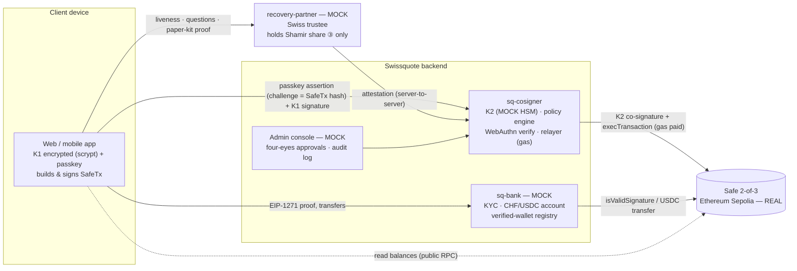

# SQ Wallet — prototype

**The self-custody wallet a Swiss bank could launch.** The client holds the keys; Swissquote adds bank-grade security as a **co-signer that can never move funds alone**; recovery works even if Swissquote disappears.
A **Safe 2-of-3 smart account on Ethereum Sepolia**: device key (passkey-protected) + Swissquote co-signer + a recovery key split 2-of-3 (paper · encrypted cloud · independent Swiss trustee).
Built for the *Swissquote Wallet Challenge* (EPFL hackathon, Oct. 2026). Not affiliated with Swissquote; no Swissquote trademarks are used.

---

## Quick start

Requirements: Node ≥ 20 (tested with Node 26 on Apple Silicon), Chrome (passkeys / Touch ID).

```bash
npm install
npm run dev          # 3 services + web app → open http://localhost:5173
```

On first start the services generate their keys and print the **relayer address** (the Swissquote account that pays gas). Fund it once with Sepolia ETH (e.g. https://cloud.google.com/application/web3/faucet/ethereum/sepolia). For the account → wallet USDC transfer, fund the **treasury address** (printed by `sq-bank`) with test USDC at https://faucet.circle.com.

| Command | What it does |
|---|---|
| `npm run dev` | Starts `sq-cosigner` (:4001), `recovery-partner` (:4002), `sq-bank` (:4003) and the web app (:5173) |
| `npm run e2e` | **Headless end-to-end run on Sepolia**: create → sign → attacker refused → recover (delay) → old key revoked on-chain → sign with the new key. Prints Etherscan links |
| `npm run escape-hatch -- --device-key … --paper … --cloud … --to 0x…` | Moves all funds with **device key + recovery key only** — no Swissquote server |
| `npm test` | Unit tests of the policy engine |
| `npm run fund-check` | Relayer / treasury balances; tops up treasury gas |
| `npm run reset-demo` | Resets demo state (keeps the funded keys) |

Demo routes: `/` client app (mobile-first) · `/admin` Swissquote back-office (MOCK) · `/attacker` scripted attack · `/recover` "I lost my device" · `/inbox` mock email/SMS.
See **[docs/DEMO_SCRIPT.md](docs/DEMO_SCRIPT.md)** for the 3-minute demo.

---

## Proof on Sepolia (headless run `npm run e2e`, 2026-10-10)

| Step | Transaction |
|---|---|
| Safe 2-of-3 deployed by the relayer (client paid no gas) | [0xf725d1d9…](https://sepolia.etherscan.io/tx/0xf725d1d9dcd5db01478e8224c05230302a8634824aa49da0fe8269f99a72ea7c) |
| Transaction signed K1 + K2, gas sponsored (Safe holds 0 ETH) | [0x475e8bc8…](https://sepolia.etherscan.io/tx/0x475e8bc8f648ec7052f28b8c8e09a0250669e2131ea42da47ed636f9da56a5e0) |
| Recovery: old device key revoked on-chain (`swapOwner`, K3 + K2, after the delay) | [0x693390bd…](https://sepolia.etherscan.io/tx/0x693390bd4719fd7eebb63668aee4ed7252f9d9c155371cb5ce89a5918d53358e) |
| Transaction with the new device key (old key refused by the co-signer) | [0x338f0fa2…](https://sepolia.etherscan.io/tx/0x338f0fa22892acb7b4719422cb1f8a60cb864a1be6c01d10f733504418f1a283) |

Safe: [0x51B970E72005600345D743D9aFf7A5f88549F93f](https://sepolia.etherscan.io/address/0x51B970E72005600345D743D9aFf7A5f88549F93f). The same run also verified the EIP-1271 proof on-chain (`0x1626ba7e`) and the refusal of an attacker holding phone + email (risk score 125).

---

## Architecture



Each service is a **separate process with its own `data/` directory** (JSON files, no native modules). The web app **never** holds share ③ or K2.

### Real vs Mock

| Element | Status |
|---|---|
| Safe 2-of-3 on Sepolia, signatures, execution, owner rotation (`swapOwner`) | **REAL** |
| USDC transfers (Circle Sepolia USDC `0x1c7D…7238`), gas sponsoring by the relayer | **REAL** |
| EIP-1271 proof of ownership verified on-chain (`isValidSignature`) | **REAL** |
| Passkeys / WebAuthn (Touch ID), challenge bound to the Safe tx hash | **REAL** (browser) |
| Shamir split of K3 (`shamir-secret-sharing`), keystore (scrypt), AES-GCM cloud backup | **REAL** libraries |
| Policy engine, simulation (`eth_call`), thresholds, delays, four-eyes | **REAL** logic (demo values) |
| Swissquote core banking, KYC, client account | **MOCK** |
| Liveness / video-ident, SMS, email (Mock Inbox) | **MOCK** |
| Sanctions list provider (Chainalysis/Elliptic in prod) | **MOCK** list (incl. real OFAC addresses) |
| Recovery partner (independent Swiss trustee) | **MOCK** service, separate process |
| HSM for K2 | **MOCK** = JSON file |
| Headless e2e client (no browser passkey) | Demo-only shortcut, flagged `headless` |

Every mocked element carries a visible **MOCK** badge in the UI.

---

## Custody model & threats (summary — full version: [docs/THREAT_MODEL.md](docs/THREAT_MODEL.md))

| Key | Holder | Lives | Role |
|---|---|---|---|
| K1 device key | Client | Browser/app, encrypted by password, unlocked + used only after a passkey | Daily signing |
| K2 co-signer | Swissquote | `sq-cosigner` only (HSM in prod) | Co-signs after checks |
| K3 recovery key | Client | Split 2-of-3: ① paper QR · ② cloud (encrypted) · ③ recovery partner | Recovery & escape hatch |

- **Normal use** K1 + K2 · **lost device** K3 + K2 → `swapOwner` after identity checks and a delay · **Swissquote gone** K1 + K3.
- Swissquote alone **cannot move** funds (1/3). Swissquote + partner **cannot** either (share ③ is 1 of 3). Swissquote **can block** (refuse to co-sign) → bounded by the escape hatch.

| Threat | Steal? | Block? | Counter-measure |
|---|---|---|---|
| Phone thief | No | No | Passkey per tx, encrypted K1, K2 refuses; rotation revokes the device on-chain |
| Phone + email | No | No | Liveness (hard), paper kit required, risk score, delay + cancel from the Swissquote account |
| SIM swap | No | No | SMS never sufficient alone; raises recovery risk |
| Swissquote / rogue employee | **No** | Yes | Escape hatch, four-eyes, audit log |
| Swissquote + partner | **No** | — | Shares split 1/3 |
| K2 stolen | Not alone | Possible | HSM, K2 rotation via K1+K3 |
| Swissquote disappears | — | No | `npm run escape-hatch` / app.safe.global |
| Phishing dApp | Reduced | — | Whitelist, sanctions, simulation, unlimited-approve alert |

### Authentication levels
| Level | When (demo) | Requires |
|---|---|---|
| **Standard** | < 50 USDC and known recipient | Password-unlocked session + **passkey** bound to the tx → K1 signs → K2 co-signs automatically |
| **Reinforced** | ≥ 50 USDC, new recipient, any dApp, unlimited approval | Passkey + **email OTP (mock)** + **cooling-off** (30 s demo / 24 h prod) + **four-eyes** approval in `/admin` |

SMS/email are notifications or a secondary factor only — never enough alone.

### Recovery
- **A — lost phone**: Swissquote login → partner: **liveness vs KYC** (mock) + 3 questions (low weight) + **paper kit** → partner releases share ③ → K3 rebuilt in the browser → new passkey + new K1 → `swapOwner(K1→K1′)` signed by K3 → **2-min delay (48 h prod)** with notifications and one-tap cancel → K2 co-signs → old device **revoked on-chain**.
- **B — phone + email stolen**: refused (liveness, no paper kit, SIM swap, risk score); real client alerted. See `/attacker`.
- **C — Swissquote disappears**: K1 + K3 (paper + cloud) → `npm run escape-hatch`, or app.safe.global (Sepolia). Extreme case (device **and** Swissquote lost): Zodiac Delay module in production (documented, not built).

---

## Compliance, custody & Travel Rule (summary — [docs/LEGAL.md](docs/LEGAL.md))
- **Non-custodial**: Swissquote holds 1 of 3 keys and cannot move funds → software + co-signing service; no crypto deposits on balance sheet. Grey zone (ability to block) stated openly and mitigated by the escape hatch. The idea of a 2nd Swissquote on-chain signature for large amounts was moved **off-chain (four-eyes)** to avoid custody.
- **Travel Rule**: the Safe is created for a KYC'd client and registered with an **on-chain EIP-1271 proof of ownership** → automatic self-hosted-wallet verification, no Satoshi test.
- **AML/sanctions**: risk-based policy engine (sanctions screening, thresholds, daily limits, dApp whitelist, simulation), shared audit log.

## Business model (summary — [docs/BUSINESS.md](docs/BUSINESS.md))
Free tier + **Premium ~5 CHF/month** (higher limits, gas included, priority human recovery, inheritance), spread on account ↔ wallet transfers and swaps, curated dApp distribution fees. **Retention**: assets stay one click from the trading account. **Costs saved**: automated Travel Rule checks, fewer support tickets, no custody capital. Illustrative: ~3 M CHF/year (assumptions in the doc).

## Bonus features implemented
- **Gasless**: the Safe never holds ETH; Swissquote's relayer submits `execTransaction` and pays gas (also for Safe deployment). Anti-abuse: KYC-linked wallets only, 20 sponsored tx/day/client, gas cap per tx, sponsoring only if the policy engine approves. Production: ERC-4337 paymaster or EIP-7702.
- **Compliant dApp interaction**: dApp whitelist (Uniswap, Aave on Sepolia), sanctions screening (refusal shown), plain-language simulation, **red alert on unlimited `approve`**, reinforced checks for every dApp interaction and above the threshold.
- **Recovery that refuses a thief with phone + email**: `/attacker` page and `npm run e2e` step 3b.

## Repository layout
```
apps/web                  Vite + React + Tailwind client app, /admin, /attacker
services/sq-cosigner      K2, policy engine, WebAuthn, relayer, recovery delay, audit log, mock inbox
services/recovery-partner Share ③ + identity checks + risk score (MOCK trustee)
services/sq-bank          MOCK core banking/KYC, EIP-1271 wallet registry, treasury USDC
packages/shared           Constants, ABIs, Safe helpers (ethers), Shamir/backup helpers, tx decoder
scripts/                  e2e-demo, escape-hatch, fund-check, reset-demo
docs/                     PLAN, THREAT_MODEL, LEGAL, BUSINESS, DEMO_SCRIPT
```

## Libraries (no custom cryptography)
`ethers` v6 (EIP-712, keystore, signatures) · Safe v1.4.1 contracts (`@safe-global/safe-deployments` addresses) · `shamir-secret-sharing` (audited) · `@simplewebauthn/browser` + `/server` v14 · WebCrypto (AES-GCM, PBKDF2) · Express 5 · React 19 · Vite 8 · Tailwind 4.
We use the Safe contracts directly with ethers rather than `@safe-global/protocol-kit`: fewer moving parts, and the SafeTx hash is cross-checked against `Safe.getTransactionHash` on-chain before co-signing.

## AI tools used
- **Claude Code (Claude Opus)** — wrote the code, scripts, tests and documentation of this repository from a design brief, as an autonomous development agent (planning, library API checks, on-chain testing on Sepolia).
- **Claude (chat)** — used by the project owner to design the product: custody model, threat model, recovery flows, legal framing and business case, consolidated into the brief that drove development.
All design decisions were reviewed by the team; legal content is not legal advice.
