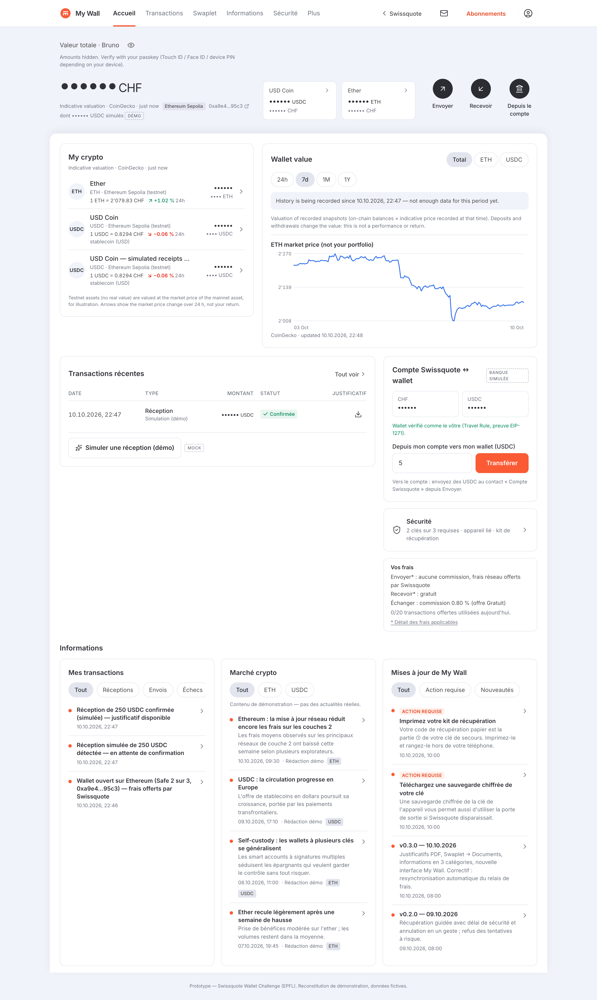
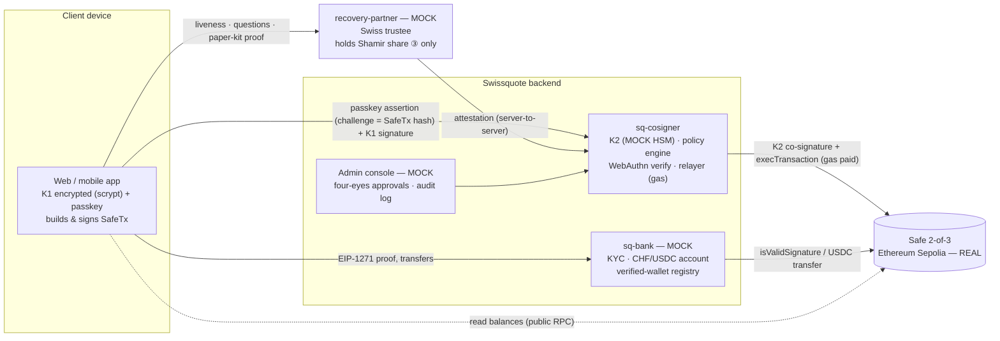

# My Wall — prototype

**The self-custody wallet a Swiss bank could launch, one tap away from the Swissquote app.** The client holds the keys; Swissquote adds bank-grade security as a **co-signer that can never move funds alone**; recovery works even if Swissquote disappears.
A **Safe 2-of-3 smart account on Ethereum Sepolia**: device key (passkey-protected) + Swissquote co-signer + a recovery key split 2-of-3 (paper code · part locked to a physical security key · independent Swiss trustee) — no cloud backup anywhere.
Built for the *Swissquote Wallet Challenge* (EPFL hackathon, Oct. 2026). Prototype with fictitious data; the Swissquote logo is used only to stage the challenge demo (reconstructed app screens are labelled as such).



---

## Quick start

Requirements: Node ≥ 20 (tested with Node 26 on Apple Silicon), Chrome (passkeys / Touch ID).

```bash
npm install
npm run dev          # 3 services + web app → open http://localhost:5173
```

On first start the services generate their keys and print the **relayer address** (the Swissquote account that pays gas). Fund it once with Sepolia ETH (e.g. https://cloud.google.com/application/web3/faucet/ethereum/sepolia). For the account → wallet USDC transfer, fund the **treasury address** (printed by `sq-bank`) with test USDC at https://faucet.circle.com.

| Command | What it does |
|---|---|
| `npm run dev` | Starts `sq-cosigner` (:4001), `recovery-partner` (:4002), `sq-bank` (:4003) and the web app (:5173) |
| `npm run e2e` | **Headless end-to-end run on Sepolia**: create → sign → attacker refused → recover (delay) → old key revoked on-chain → sign with the new key; then `e2e-protection`: guard + D1/D2, refusals, veto, protected exit, recovery through D1, K3 alone via D2. Prints Etherscan links |
| `npm run test:contracts` | MyWallGuard tests on official Safe / Zodiac bytecode (Hardhat in-process; also run by `npm test`) · `npm run build:contracts` recompiles · `npm run deploy:guard` (Sepolia, once) |
| `npm run escape-hatch -- --device-key … --paper … (--security-key <part.json> --prf-output <hex> \| --offline <file.json>) --to 0x…` | Moves all funds with **device key + recovery key only** — no Swissquote server |
| `npm test` | Unit tests: policy engine, recovery code, question picker, answer normalisation, password policy (22 tests) |
| `npm run screenshots` | Playwright captures at 3 sizes (virtual passkey authenticator) |
| `npm run fund-check` | Relayer / treasury balances; tops up treasury gas |
| `npm run reset-demo` | Resets demo state (keeps the funded keys) |

Demo routes: `/sq` reconstructed Swissquote app (entry: **"Mon wallet" pull-up tab** on mobile/tablet, **"Mon wallet" button** on desktop) · `/wallet` My Wall · `/wallet/transactions` · `/wallet/swaplet` (receipts) · `/wallet/info` · `/wallet/security` · `/recover` · `/admin` Swissquote back-office (MOCK) · `/attacker` scripted attack · `/inbox` mock email/SMS.
The UI is in **French**; code and docs are in English. `npm run screenshots` captures every key screen at 390×844, 820×1180 and 1440×900 into `docs/design/screens/`.
See **[docs/DEMO_SCRIPT.md](docs/DEMO_SCRIPT.md)** for the 3-minute demo.

---

## Proof on Sepolia (headless run `npm run e2e`, 2026-10-10)

| Step | Transaction |
|---|---|
| Safe 2-of-3 deployed by the relayer (client paid no gas) | [0xf725d1d9…](https://sepolia.etherscan.io/tx/0xf725d1d9dcd5db01478e8224c05230302a8634824aa49da0fe8269f99a72ea7c) |
| Transaction signed K1 + K2, gas sponsored (Safe holds 0 ETH) | [0x475e8bc8…](https://sepolia.etherscan.io/tx/0x475e8bc8f648ec7052f28b8c8e09a0250669e2131ea42da47ed636f9da56a5e0) |
| Recovery: old device key revoked on-chain (`swapOwner`, K3 + K2, after the delay) | [0x693390bd…](https://sepolia.etherscan.io/tx/0x693390bd4719fd7eebb63668aee4ed7252f9d9c155371cb5ce89a5918d53358e) |
| Transaction with the new device key (old key refused by the co-signer) | [0x338f0fa2…](https://sepolia.etherscan.io/tx/0x338f0fa22892acb7b4719422cb1f8a60cb864a1be6c01d10f733504418f1a283) |

**Web UI, real Sepolia** (automated browser run with a virtual WebAuthn authenticator, real USDC):

| Step | Transaction |
|---|---|
| Wallet created from the UI (passkey, recovery kit) | [0xf4539550…](https://sepolia.etherscan.io/tx/0xf4539550794146e587c41f6f6db6563eab58fb746d16a45a2c20a0bd6986db54) |
| 1 USDC sent, standard level (passkey + K1 + K2, Safe holds no ETH) | [0x1dfa31cd…](https://sepolia.etherscan.io/tx/0x1dfa31cd21e8560be2ba4e40ba010196685bae1d11144a0d6ef25dffb1fa5563) |
| 0.5 USDC to a new recipient, reinforced (email OTP + cooling-off + four-eyes in /admin) | [0xcd02ce42…](https://sepolia.etherscan.io/tx/0xcd02ce4238f89241a450e7926cfa310456136a20b105be542d8420abe2d36d64) |
| "I lost my device" recovery: old device revoked on-chain | [0xfad942f4…](https://sepolia.etherscan.io/tx/0xfad942f485a7f5164e0dadce109c0903c8ae59da4f8cf224748fb5815bb561a7) |
| 1.5 USDC sent from the new device | [0x6da97a75…](https://sepolia.etherscan.io/tx/0x6da97a75ac0d7155f8113a7cc59b6f6baa6fff3feda13bffa41f920f3cf6e801) |

Headless run Safe: [0x51B970E72005600345D743D9aFf7A5f88549F93f](https://sepolia.etherscan.io/address/0x51B970E72005600345D743D9aFf7A5f88549F93f). The same run also verified the EIP-1271 proof on-chain (`0x1626ba7e`) and the refusal of an attacker holding phone + email (risk score 125).

**On-chain protection — MyWallGuard + Zodiac Delay D1 / D2** (`scripts/e2e-protection.ts`, part of `npm run e2e`, 2026-10-10; details in [docs/ONCHAIN_PROTECTION.md](docs/ONCHAIN_PROTECTION.md), guard **not audited**):

| Step | Transaction |
|---|---|
| MyWallGuard deployed once (singleton, source verified on Sourcify) | [0xe7a2f66b…](https://sepolia.etherscan.io/tx/0xe7a2f66b5d56823ca449af78480dd4e4240fe20b186f5f9493a40f86b8deb4ff) — [contract](https://sepolia.etherscan.io/address/0xDb2eD8936CdE1844602dd5791E7E091aaE2dEc5e) |
| Protection activated: D1 + D2 deployed and enabled, guard configured and set — one K1 + K2 batch | [0xe2e543c7…](https://sepolia.etherscan.io/tx/0xe2e543c7214bb16f42ff36329093262fbc2800ccd927245d4789999119abdb11) |
| Emergency gas reserve (0.002 ETH) deposited on the recovery key's address | [0x029f9d6b…](https://sepolia.etherscan.io/tx/0x029f9d6b4b6cf655fa5dcb9988b71e7f251cbc920a2a01a54da007ed78025f4d) |
| K2 + K3 direct (`swapOwner`) → **reverted by the guard** (lab Safe with a test K2) | [0x201dac64…](https://sepolia.etherscan.io/tx/0x201dac642a64a6f8d0ce641b633ef7e3a8026e2872ff322bd3dd7188c3878c64) |
| K1 + K3 direct transfer → **reverted by the guard** | [0xd7513603…](https://sepolia.etherscan.io/tx/0xd75136037244db215636cb870dddab0f0189bdfe918d98e17546d72dc14ac212) |
| K1 + K2 transfer → immediate (guard active) | [0x53b2a65a…](https://sepolia.etherscan.io/tx/0x53b2a65a15fb1514577c8abf9aa41b23819acd5f7452cc5dddf5814dafaaa67e) |
| K1 + K3 queue an operation in D1 → **vetoed** by K1 + K2 (`setTxNonce`) | [0x4683ab0d…](https://sepolia.etherscan.io/tx/0x4683ab0d57c8bd49b94f5a62bb55973d03dd8e5e242d10c24e1ae8dcb3642d89) → [0xd635e3f2…](https://sepolia.etherscan.io/tx/0xd635e3f2ba163e77eac26713a069f0f890f3af0769c81f69002ff4c5e78df65d) |
| **Protected exit** K1 + K3: withdrawal queued in D1, executed after the delay by K3 alone (gas from the reserve, no Swissquote) | [0x122652bf…](https://sepolia.etherscan.io/tx/0x122652bfef42d2603a32eee35b8b7df30b44e138262eabc7d76714a132c30ef8) → [0x84e8883e…](https://sepolia.etherscan.io/tx/0x84e8883ea09bafa075815cc03282216463778929e9d96e02c7f07ea6eaa6fcdf) |
| "I lost my device": `swapOwner` queued in D1 by K3 + K2, executed after the on-chain countdown (`executeNextTx`, relayer) | [0x35dba4fb…](https://sepolia.etherscan.io/tx/0x35dba4fb159e19550545ca3b0651a13b6850308b6ebd82a04b27d46780dc4e68) → [0x4a5433c8…](https://sepolia.etherscan.io/tx/0x4a5433c8bb84803ad266be66fc6fde44979bf6b7522fffb9fae11aa51de1b27e) |
| New device key K1′ + K2 → immediate (the guard reads K1 dynamically) | [0xbdbbe30b…](https://sepolia.etherscan.io/tx/0xbdbbe30bde46797c2afbe7e9cb9a1afbf4597802f1ca63ebee2f192c5cafa1c6) |
| **K3 alone** queues in D2, executes after D2's longer delay | [0x0fb0a629…](https://sepolia.etherscan.io/tx/0x0fb0a629c7e92c56178099413dcd7a2777ed402a6dcf359253ff6ee7548986d7) → [0xea8eddbc…](https://sepolia.etherscan.io/tx/0xea8eddbccca5a659eed2ace50ea84d2ad8d7645f66a01776022f9dbde9437cfe) |

Protected Safe: [0xc2C8C93884E7f36C9f0497fbd540995885274f05](https://sepolia.etherscan.io/address/0xc2C8C93884E7f36C9f0497fbd540995885274f05) (D1 `0x8BE0…3aEC`, D2 `0x514F…9737`).


---

## Architecture



Each service is a **separate process with its own `data/` directory** (JSON files, no native modules). The web app **never** holds share ③ or K2.

### Real vs Mock

| Element | Status |
|---|---|
| Safe 2-of-3 on Sepolia, signatures, execution, owner rotation (`swapOwner`) | **REAL** |
| On-chain protection: MyWallGuard (custom, **not audited**) + Zodiac Delay D1 / D2, veto, protected exit, recovery through D1 | **REAL** on Sepolia (demo delays 2 / 4 min; production 48 h / 30 days) |
| USDC transfers (Circle Sepolia USDC `0x1c7D…7238`), gas sponsoring by the relayer | **REAL** |
| EIP-1271 proof of ownership verified on-chain (`isValidSignature`) | **REAL** |
| Passkeys / WebAuthn (Touch ID), challenge bound to the Safe tx hash | **REAL** (browser) |
| Shamir split of K3 (`shamir-secret-sharing`), keystore (scrypt); part ② encrypted with AES-GCM under an HKDF key from the security key's WebAuthn PRF output, or (fallback) scrypt + AES-GCM offline file | **REAL** libraries (WebAuthn PRF tested with Chrome's virtual FIDO2 authenticator; the headless e2e client simulates the PRF output — test only) |
| Policy engine, simulation (`eth_call`), thresholds, delays, four-eyes | **REAL** logic (demo values) |
| Swissquote core banking, KYC, client account | **MOCK** |
| Liveness / video-ident, SMS, email (Mock Inbox) | **MOCK** |
| Sanctions list provider (Chainalysis/Elliptic in prod) | **MOCK** list (incl. real OFAC addresses) |
| Recovery partner (independent Swiss trustee) | **MOCK** service, separate process |
| HSM for K2 | **MOCK** = JSON file |
| Headless e2e client (no browser passkey) | Demo-only shortcut, flagged `headless` |
| Identity-document check at activation (images processed locally, never sent) | **MOCK** (outcome only stored in `sq-bank`) |
| Transaction receipts (PDF, jsPDF, client-side) and receipts index (idempotent `docId`) | **REAL** logic |
| "Simuler une réception" (250 USDC, no blockchain tx) | **MOCK**, flagged "simulée" everywhere |
| Reconstructed Swissquote screens and the demo trading account (portfolio values, cash, orders) | **MOCK** (fictitious, labelled) |
| Market quotes, history, search (Trade, Watchlist, instrument pages, alerts, wallet CHF valuations) | **REAL** data — Yahoo Finance public endpoints + CoinGecko, via `services/market-data` |
| News | **REAL** articles from publishers' RSS feeds (headline, summary, image credit, link — no full text) |
| Inspiration articles | Editorial prototype content, sourced (not market data, not advice) |
| Price / % / reminder alerts | **REAL** evaluation by the demo server every minute while it runs; in-app notifications only |
| Order ticket (Buy / Sell) | **MOCK** — never sends an order |
| Travel Rule (#9) | **REAL** IVMS101 messages (validated), **REAL** Ed25519 signatures (node:crypto), **REAL** EIP-191 ownership proofs; the Travel Rule **network is SIMULATED**: one counterparty VASP (`services/vasp-mock`, "Demo Exchange AG", port 4005) and a static address → VASP directory. Production: a real network (TRP / OpenVASP or a commercial provider), to be chosen with compliance |
| External wallet proof (SIWE / EIP-4361, EIP-1271) | **REAL** signature verification (free, no transaction) |
| Annual statement / CSV | **REAL** chain reconstruction at 31.12 Europe/Zurich; valuation = CoinGecko estimate (official ESTV rates not integrated) |
| Native iOS / Android app (Capacitor) | Projects generated and synced; **not compiled** here (no Xcode / Android SDK) |
| Recovery code (paper share ①) as checksummed base32 text — no QR code | **REAL** encoding |
| K2 / relayer keys encrypted at rest (keystore + `SERVICE_MASTER_KEY`) | **REAL** (HSM in production) |
| Subscriptions & payment | **MOCK** payment (demo mode, nothing charged); prices, entitlements and commission maths are real server-side logic |
| Token exchange (Swaplet → Échanger) | **MOCK** execution: real server-side quote, never executed |
| Fee-change demo control (2 → 8 CHF) | **MOCK**, labelled in the UI |
| Messages to contacts / referent `moncontact@swissquote.ch` | Local draft + `mailto:` only — no message is sent by the app; the referent address is a mock-up |
| Device-key backup: ethers keystore v3 (scrypt + AES-128-CTR + MAC) | **REAL** library |
| External receipts (any token, ETH via `SafeReceived`) indexed from the chain, history row + receipt | **REAL** (public RPCs; own nodes / indexing provider in production) |
| Unrecognised tokens & look-alike addresses (address poisoning) detection, refusal by the policy engine | **REAL** logic |
| Pre-send checks (token contract, contract recipient, other-chain address formats), EIP-681 receive QR | **REAL** logic |
| Emergency mode (balances read from the chain without any Swissquote service) | **REAL** reads; guided exit arrives with the wallet security upgrade (Phase B) |
| Co-signer response-time commitments, contest procedure | Documented ([docs/COSIGNER_COMMITMENTS.md](docs/COSIGNER_COMMITMENTS.md)); decision log **REAL** |

Honesty about what is simulated lives here and on the discreet **About this prototype** page (`/about`, linked from the footer and Wallet → More); no extra badges are added to screens. Each simulated element, its planned production integration (FINMA-approved video identification, sanctions data provider, HSM, fiduciary partner, Travel Rule network…), risk and effort: **[docs/PRODUCTION_READINESS.md](docs/PRODUCTION_READINESS.md)**.

---

## Custody model & threats (summary — full version: [docs/THREAT_MODEL.md](docs/THREAT_MODEL.md))

| Key | Holder | Lives | Role |
|---|---|---|---|
| K1 device key | Client | Browser/app, encrypted by password, unlocked + used only after a passkey | Daily signing |
| K2 co-signer | Swissquote | `sq-cosigner` only (HSM in prod) | Co-signs after checks |
| K3 recovery key | Client | Split 2-of-3: ① paper code (steel plate advised) · ② physical security key (FIDO2 PRF; Swissquote stores only the ciphertext) · ③ recovery partner | Recovery & escape hatch |

- **Normal use** K1 + K2 · **lost device** K3 + K2 → `swapOwner` after identity checks and a delay · **Swissquote gone** K1 + K3.
- Swissquote alone **cannot move** funds (1/3). Swissquote + partner **cannot** either (share ③ is 1 of 3). Swissquote **can block** (refuse to co-sign) → bounded by the escape hatch.

| Threat | Steal? | Block? | Counter-measure |
|---|---|---|---|
| Phone thief | No | No | Passkey per tx, encrypted K1, K2 refuses; rotation revokes the device on-chain |
| Phone + email | No | No | Liveness (hard), paper kit required, risk score, delay + cancel from the Swissquote account; part ② needs the physical key, which a phone thief does not have |
| SIM swap | No | No | SMS never sufficient alone; raises recovery risk |
| Swissquote / rogue employee | **No** | Yes | Escape hatch, four-eyes, audit log |
| Swissquote + partner | **No** | — | Shares split 1/3 |
| K2 stolen | Not alone | Possible | HSM, K2 rotation via K1+K3 |
| Swissquote disappears | — | No | `npm run escape-hatch` / app.safe.global |
| Phishing dApp | Reduced | — | Whitelist, sanctions, simulation, unlimited-approve alert |

### Authentication levels
| Level | When (demo) | Requires |
|---|---|---|
| **Standard** | < 50 USDC and known recipient | Password-unlocked session + **passkey** bound to the tx → K1 signs → K2 co-signs automatically |
| **Reinforced** | ≥ 50 USDC, new recipient, any dApp, unlimited approval | Passkey + **email OTP (mock)** + **cooling-off** (30 s demo / 24 h prod) + **four-eyes** approval in `/admin` |

SMS/email are notifications or a secondary factor only — never enough alone.

### Recovery
- **A — lost phone**: Swissquote login → partner: **liveness vs KYC** (mock) + 3 questions (low weight) + **paper kit** → partner releases share ③ → K3 rebuilt in the browser → new passkey + new K1 → `swapOwner(K1→K1′)` signed by K3 → **2-min delay (48 h prod)** with notifications and one-tap cancel → K2 co-signs → old device **revoked on-chain**.
- **B — phone + email stolen**: refused (liveness, no paper kit, SIM swap, risk score); real client alerted. See `/attacker`.
- **C — Swissquote disappears**: K1 + K3 (paper + security key, or paper + offline file) → `npm run escape-hatch`, or app.safe.global (Sepolia). Extreme case (device **and** Swissquote lost): Zodiac Delay module (see on-chain protection).

### Recovery key parts — no cloud (N2)
The cloud backup was removed: a cloud account is reachable from a stolen, unlocked phone. K3 is split Shamir 2-of-3 (generic 2-of-N, ready for a trusted-contact 4th part):

| Part | Held by | Protection |
|---|---|---|
| ① Paper code | Client — printed, ideally **engraved on a steel plate**, at home or in a bank safe-deposit box | 19 groups of 4 checksummed characters |
| ② Security key | Client's **physical FIDO2 key** (e.g. YubiKey) or second device | A dedicated WebAuthn credential with the **PRF extension** (CTAP2 hmac-secret) evaluates a fixed per-wallet salt inside the key; HKDF-SHA256 → AES-256-GCM key (WebCrypto). **Swissquote (sq-cosigner) stores only the ciphertext** (`/clients/:id/recovery-kit`, session-protected); an offline copy is downloadable. Opening it needs the key, present and touched. |
| ② fallback | Client — **offline file** on a USB stick, only when no PRF-capable key exists | scrypt (N = 2¹⁷) + AES-256-GCM, a **distinct backup password** (same rules as the wallet password, must differ from it), labelled "Keep offline — never upload to a cloud". Never sent to Swissquote. |
| ③ Partner | Independent recovery partner (mock) | Released after identity checks; the partner **never holds part ②**, so no single party keeps two parts. |

Valid pairs in `/recover`: paper + security key, paper + partner, security key + partner. The shared function `reconstructK3FromShares()` (packages/shared) is the single entry point (recover, escape hatch, protected exit).

**Replace my recovery kit / "Replace cloud backup"** (Security): re-splitting the *same* K3 would not retire anything — an old paper code plus an old cloud file would still rebuild it. So the device creates a **new K3′**, splits it (new paper code, new security-key part, new partner share) and **K1 + K2 swap K3 → K3′ on-chain** (immediate). On a protected wallet the swap is one MultiSendCallOnly batch that also moves the guard configuration and the D2 queuer to K3′ (tested in `contracts/test/recoveryRotation.test.ts`, including the counter-example). The partner activates its new share only after the on-chain swap. Old parts then rebuild a key that owns nothing. Residual: the emergency gas reserve deposited on the old K3 address stays there (testnet amount).

---

## Compliance, custody & Travel Rule (summary — [docs/LEGAL.md](docs/LEGAL.md))
- **Non-custodial**: Swissquote holds 1 of 3 keys and cannot move funds → software + co-signing service; no crypto deposits on balance sheet. Grey zone (ability to block) stated openly and mitigated by the escape hatch. The idea of a 2nd Swissquote on-chain signature for large amounts was moved **off-chain (four-eyes)** to avoid custody.
- **Travel Rule**: the Safe is created for a KYC'd client and registered with an **on-chain EIP-1271 proof of ownership** → automatic self-hosted-wallet verification, no Satoshi test.
- **AML/sanctions**: risk-based policy engine (sanctions screening, thresholds, daily limits, dApp whitelist, simulation), shared audit log.

## Business model (summary — [docs/BUSINESS.md](docs/BUSINESS.md))
Three tiers — **Free** (0.80 % service commission on eligible exchanges), **Plus** 7 €/month · 70 €/year · or 12 instalments (0.40 %), **Pro** 15 €/month · 150 €/year · or 12 × 12.50 € (0.20 %). No commission on transfers; plan discounts apply to our commission only. Server-side entitlements and integer arithmetic; demo payment mode (nothing charged). Benchmark, cost comparator and an illustrative contribution-margin estimate: **[docs/PRICING.md](docs/PRICING.md)**. **Retention**: assets stay one click from the trading account. **Costs saved**: automated Travel Rule checks, fewer support tickets, no custody capital.

## Bonus features implemented
- **Gasless**: the Safe never holds ETH; Swissquote's relayer submits `execTransaction` and pays gas (also for Safe deployment). Anti-abuse: KYC-linked wallets only, 20 sponsored tx/day/client, gas cap per tx, sponsoring only if the policy engine approves. Production: ERC-4337 paymaster or EIP-7702.
- **Compliant dApp interaction**: dApp whitelist (Uniswap, Aave on Sepolia), sanctions screening (refusal shown), plain-language simulation, **red alert on unlimited `approve`**, reinforced checks for every dApp interaction and above the threshold.
- **Recovery that refuses a thief with phone + email**: `/attacker` page and `npm run e2e` step 3b.

## Wallet-level security
What this repository implements at the wallet level (the security of Swissquote's infrastructure — HSMs, network, key ceremonies, SOC — is Swissquote's responsibility and is **not** attested by this work):

- **Keys encrypted at rest** — K2 (one per client) and the relayer key are stored as ethers keystore JSON (scrypt + AES-128-CTR + MAC) in `services/sq-cosigner/data/keys.json`, unlocked with `SERVICE_MASTER_KEY` from the environment. In local development a strong value is generated once into the git-ignored `.env` (mode 600); in production it must come from a durable secret store (the service refuses to start without it, and never generates a new master key when encrypted keys already exist). The master key is never written next to the keystores nor logged.
- **Migration** — the former plaintext `keys.json` is migrated on start-up: encrypt → decrypt and compare every address **and** private key → atomic rename (tmp + fsync). It is idempotent (an encrypted file is left untouched) and no key is regenerated: the relayer and all K2 keep their exact addresses, so Safes already deployed on Sepolia keep working. Verified on this repo's real keys (5/5 identical).
- **Independent validation by `sq-cosigner`** — before any co-signature it re-decodes the SafeTx itself (`validate.ts`): only ETH transfers, ERC-20 `transfer` / `approve` on supported tokens and `swapOwner` (recovery route only); calldata must be the exact canonical encoding (no trailing bytes); `operation` must be CALL; no gas-refund parameters; no ETH attached to token calls. Everything else is refused.
- **Previews bound to the exact transaction** — every simulation shown to the client creates a single-use preview (60 s) stored server-side with the canonical SafeTx. Submission must reference it; a SafeTx that differs in any byte is refused, an expired or reused preview is refused, and a significant change of conditions (network fee ≥ 25 % **and** ≥ 0.50 CHF; swap quote ≥ 0.5 %) requires a new confirmation.
- **Passkey bound to the SafeTx** — the WebAuthn challenge is `keccak256("MyWall/cosign/v1", chainId, Safe address, SafeTx hash (EIP-712 domain incl. chain + Safe), nonce, preview id)`, verified server-side (origin, RP ID, user verification, counter) and usable once.
- **Freeze co-signing** — a switch in *Sécurité* (passkey-protected, challenge bound to the action and the wallet; the backup code cannot do it). While frozen, K2 is never released (`cosignerWallet` is the single choke point): no transaction, pending reinforced request, ownership proof or recovery gets a co-signature. The Safe's owners and threshold are unchanged, so the K1 + K3 exit remains possible.
- **Backup code** (passkey alternative) — 12 characters from a CSPRNG, shown once, confirmed, revocable; stored only as a salted scrypt hash; 5 attempts then a 15-minute lock; each use bound to a single-use challenge or preview. It can unlock and confirm operations, never freeze/unfreeze, reveal amounts or reveal secrets.
- **Duress code (#16, optional)** — typed instead of the wallet password at unlock, it opens a **decoy** wallet (same screens, small fictitious balance, no real address / contact / history; served from memory by `apps/web/src/lib/decoy.ts`, no real key) and **silently** freezes co-signing (as a compliance freeze: the client cannot lift it under pressure, real operations get 423) + raises a **duress alert** in the console. Only a salted scrypt hash of a device-derived proof is stored; every unlock performs the same check (random value when the password is right) → same work, requests and latency. Nothing in the DOM, storage or the client's activity reveals it. Server: `services/sq-cosigner/src/duress.ts`.
- **Protective limits (#16)** — daily limit chosen by the client (Security): **lowering is immediate**, **raising takes effect after 24 h** (demo 60 s, `LIMIT_RAISE_DELAY_SEC`) with notifications and a cancel button; a first payment ≥ the step-up threshold to a new recipient is **always** delayed (code + cooling-off + four-eyes; policy check `new-recipient-delay`).
- Tests: `services/sq-cosigner/test/security.test.ts` (encrypted key keeps its exact address · modified calldata refused · frozen wallet gets no co-signature) and `npm run e2e` (a transaction modified after its preview is refused on the live co-signer).

### Service authentication, CORS & CSRF
All four services install the same shared middleware (`packages/shared/src/serverAuth.ts`, `@sq/shared/server`) **before any route**:

- **Session tokens** — sq-bank `/login` issues a compact token `{sub: clientId, role: client|compliance, iat, exp, jti, fresh?}` signed with HMAC-SHA256 (`node:crypto`) and `SESSION_SIGNING_KEY`; every service verifies it (12 h for a client, 8 h for the console, 5 min when `fresh`). The web app sends it as `Authorization: Bearer …` (`apps/web/src/lib/api.ts`); a refused token clears the session and returns to the login screen.
- **Default-deny authorisation** — only the routes a service lists as public are reachable without a token. Everything else needs a session and a client token may only act on **its own** client: `/clients/:id/…`, any `clientId` in the body or query (non-string values are refused), and the owner of resources addressed by id (`/tx/:id`, `/recovery/:id`, `/wallet-txs/:id`, `/scheduled/:id`, partner `/sessions/:id`). Routes added later under `/clients/:id/…` are covered automatically. `/admin/*` (compliance console) needs the `compliance` role (DEMO user `compliance`, any password).
- **Public routes** — cosigner `GET /health`, `GET /config`, `GET /pricing`; partner `GET /health`; bank `GET /health`, `POST /login`; market-data every `GET` (public read-only data).
- **Service-to-service** — bank → cosigner (receipt tracking), cosigner → partner (attestations), partner → cosigner (recovery alerts), cosigner → bank (verified wallets) and the dev scripts use `x-internal-token: INTERNAL_API_TOKEN`. A request carrying an `Origin` header cannot use it, and the Origin is never taken as an identity.
- **CORS** — explicit allow-list `ALLOWED_ORIGINS` (default dev: `http://localhost:5173`, `http://127.0.0.1:5173` and the Capacitor app origins `capacitor://localhost`, `http://localhost`, `https://localhost`); the exact origin is echoed, never `*`, no credentials; methods `GET, POST, OPTIONS`; headers `content-type, authorization, x-lang`. A request with any other Origin is refused (403) before any handler runs, preflight included.
- **CSRF** — the token is not a cookie, so the browser never attaches it to a cross-site request: classic CSRF does not apply. Defence in depth: every `POST` must be `application/json` (an HTML form cannot send that → 415) and hostile origins are refused first.
- **Resets** — `POST` only (`GET` → 405) and absent when `NODE_ENV=production` (404). Global `/admin/reset`: internal token (`npm run reset-demo`) or a compliance session. Per-client `/admin/clients/:id/reset` ("Demo: restart activation"): that client's session **plus** a fresh re-authentication (bank `POST /reauth`, password re-entered, 5-minute token). `npm run e2e` obtains a session for its headless client from bank `POST /admin/test-session` (internal token, non-production).
- **Secrets** — `SESSION_SIGNING_KEY` and `INTERNAL_API_TOKEN` are generated once into the git-ignored `.env` (mode 600, never logged) in development; in production the services refuse to start without them and without `ALLOWED_ORIGINS`.
- **Bind address** — every service listens on `127.0.0.1` by default (`HOST` overrides; the log prints the real bound address). Only Vite is exposed in phone / tunnel mode: the page then calls `/svc/<service>` on its own origin and Vite proxies to loopback (`apps/web/vite.config.ts`, details in [docs/MOBILE.md](docs/MOBILE.md)). Check: `npm run check-bind` (lsof) and `packages/shared/test/listen.test.ts`.
- Tests: `services/sq-cosigner/test/auth.test.ts` (allowed / hostile origin, preflight, no token, other client's token, form-encoded POST, GET reset, reset without / with token, fresh re-authentication, production, expired / tampered / escalated tokens) — every refusal is checked to leave the state unchanged.

## Iteration 4 — markets, content, privacy, compliance, app ([spec](docs/SPEC_ITERATION4.md))

**Market data** — `services/market-data` (:4004) is the single source for every screen (Trade, Watchlist, instrument pages, alerts, wallet widgets, CHF conversions in the co-signer), so values never contradict each other.
- Providers: **Yahoo Finance** chart/search endpoints (equities, ETFs, indices; free public endpoints *without an official API contract* — fine for a prototype, replace with a licensed feed such as SIX in production) and **CoinGecko** public API (crypto, priced in CHF; attribution required). No key needed; optional `COINGECKO_API_KEY` (server-side only) raises the limits.
- Identifiers are the providers' exact ones (`yf:NESN.SW` = Nestlé on SIX, `cg:ethereum`). Each quote carries exchange, currency, time of the price in the exchange timezone, and status: *delayed* (exchange data, usually ~15–20 min), *last close* (market closed, weekends/holidays from the exchange's trading periods), or *24h* rolling for crypto.
- Cache: quotes 60 s, history 2 min–6 h depending on the period, news 10 min. On a provider error the last good value is served **flagged stale with its fetch time**; with no previous value the UI shows "unavailable" — nothing is invented. Period changes on charts are computed from that period's real history.
- Wallet CHF values use `/wallet-rates` (timestamped, indicative — not an executable quote). The former fixed rates (1 ETH = 2 900 CHF…) are gone: a missing rate is shown as unavailable, and the policy engine treats an unvalued ETH transfer as *above* the step-up threshold. Receipts use the rate captured at confirmation.

**News & Inspiration** — real articles from CNBC, MarketWatch, CoinDesk, Cointelegraph and Decrypt RSS (title, summary, credited image, original link; full text not reproduced, paywalls untouched). Seven sourced, bilingual editorial articles. Shared reader view (full screen on mobile, scroll position and focus restored on return).

**Watchlist & alerts** — stored per client in `sq-bank`. Alerts (price above/below, % change over 1D/1W, dated reminder in Europe/Zurich) are evaluated **every 60 s by the demo server while it runs** (`ALERT_EVAL_MS`), with hysteresis (no repeated notification for the same crossing); notifications are in-app only — no push/e-mail/SMS.

**Wallet privacy & widgets** — once My Wall is unlocked (password + passkey) amounts are shown in clear — no manual masking. **Privacy lock**: as soon as the user leaves (tab hidden / `visibilitychange`, `pagehide`, native app background, return from sleep, or 60 s without activity in the demo — 5 min in production, `VITE_PRIVACY_IDLE_SECONDS`), the wallet is **unmounted** behind a privacy screen (logo + “My Wall is locked”, no figure in the DOM; the page is hidden synchronously so the tab-switcher / recent-apps preview shows nothing). Showing it again needs a passkey user verification (purpose `resume-session`) or, as fallback, the wallet password checked locally by decrypting the keystore. The initial unlock and the signing rules are unchanged (`apps/web/src/lib/privacy.ts`, `privacyLock.ts`). On the Swissquote side the My Wall value reads “Unlock My Wall to see” until the wallet is unlocked. **Appearance**: System (default) / Light / Dark in Settings, System follows `prefers-color-scheme` live; two designed palettes in `apps/web/src/index.css`, AA contrast checked by `apps/web/test/theme.test.ts`. Crypto list with quantity, value, unit price and 24h change (arrow + sign). Portfolio chart built **only from recorded snapshots** (on-chain quantities + the rate in force at that time, every 15 min while the co-signer runs): no back-filling with current quantities; when history is short, a separately titled *market price* chart is shown instead; deposits/withdrawals are marked and the chart is labelled valuation, not return.

**Receive QR** — encodes the EIP-681 URI `ethereum:<checksummed Safe address>@11155111` (address + Sepolia chain id only — no amount, key, code or session data), with the network shown prominently; the bare address stays copyable for scanners that refuse URIs; decoding verified in tests (#20).

**Compliance** — send flow distinguishes *my own wallet* (verified wallets only) from *someone else's wallet* (beneficiary name always; enhanced data from a configurable CHF 1'000 threshold incl. 30-day linked transfers; missing rate ⇒ treated as above). Checked server-side at prepare and again before co-signing. **#9 Travel Rule transmission**: to an address managed by a VASP (directory), the co-signer sends a signed IVMS101 inquiry over a TRP-like API to that VASP (simulated: `services/vasp-mock`) and K2 co-signs only after its signed "approved"; to a personal wallet, the beneficiary proves ownership by signing a message (EIP-191, page `/prove-wallet`), or — below the threshold only — the client declares it. External wallets proven with **SIWE (EIP-4361)** / EIP-1271. Annual statement (31.12 23:59:59 Europe/Zurich, balances read from the chain at that block) + CSV export (UTF-8, formula-injection safe). Sources and limits: [docs/COMPLIANCE.md](docs/COMPLIANCE.md).

**Language** — English by default (also on first visit, whatever the browser locale); French on explicit choice (login page switch or Settings → Language), persisted on the device; server messages follow the `x-lang` header.

**Security** — services require signed sessions, CORS allow-list, CSRF defences, protected resets: see *Service authentication, CORS & CSRF* below.

**Web and App** — see *Web and App versions* below and [docs/MOBILE.md](docs/MOBILE.md).

New environment variables (all optional in development): `COINGECKO_API_KEY`, `MARKET_URL`, `ALERT_EVAL_MS`, `VASP_PORT` / `VASP_DATA_DIR` (vasp-mock), `SESSION_SIGNING_KEY`, `INTERNAL_API_TOKEN`, `ALLOWED_ORIGINS`, `VITE_API_HOST`.

## Iteration 3
Simulation before signing (debited / estimated received / network fee / service commission / balances before → after / approvals with cap), unlimited-approval warning with cap limiting, preview expiry and re-confirmation, recipient verification (full address, look-alike characters highlighted), authorised-apps centre with on-chain revocation, scheduled payments & reminders (never auto-signed), subscriptions & fees page, demo exchange quote, display personalisation (background, accent, highlight, hidden wallets), amount masking (reveal with passkey), message composer (local draft + your own email client; nothing is sent by the app), biometrics alternatives.

## My Wall UX highlights
- **Entry from the Swissquote app**: pull-up "Mon wallet" tab (swipe or tap, keyboard accessible) on touch devices; "Mon wallet" button next to the account icon on desktop.
- **Unlock** = wallet password (decrypts the device key locally, 5 attempts then a 30 s wait) **then** passkey. A recovery code or private key is never asked to open the wallet.
- **Activation in 7 steps**: welcome → ID document (simulated) → passkey → password (≥ 15 chars, ≥ 5 letters incl. upper + lower, ≥ 2 digits, ≥ 1 special, no name / birth date — live checklist) → 3 distinct questions out of 15 (answers normalised and scrypt-hashed by the partner, never stored in clear) → wallet creation → recovery kit **without QR code** (masked code, 30 s reveal, print sheet, copy, steel-plate advice) + **physical security key** for part ② (or offline file fallback).
- **Transactions**: statuses détectée → en attente → confirmée / échouée (confirmed = 1 block on Sepolia, `CONFIRMATIONS` env); orange check animation **only** on confirmation; PDF receipt (reference `MW-YYYYMMDD-<hash8>`, fees, Europe/Zurich time, full addresses, names only when known, no secrets) available from the transaction and from **Swaplet → Documents** without duplicates.
- **Keys & security**: public address / device private key / recovery code clearly separated; secrets revealed 30 s after password + passkey re-authentication, re-masked on expiry, page exit or background; encrypted device-key backup export + verification (wrong password, altered file, other wallet).
- **Informations** in 3 stable categories (my transactions · crypto market (demo content) · My Wall updates with "Action requise"), read/unread, filters kept in the URL.

## Assumptions (documented, not blocking)
- **Swaplet**: its final role is not defined yet; in the demo it is My Wall's space for exchanges and receipts — "Documents" is complete, "Échanger" is shown as *Prochaine version*.
- Keys: K1 device / K2 Swissquote / K3 recovery (split 2-of-3); there is **no 12/24-word seed phrase**. Custody model unchanged (2-of-3, non-custodial).
- Encryption is real (ethers keystore, WebCrypto AES-GCM + PBKDF2); identity verification is simulated (future FINMA-approved video-ident provider, retention and access to be defined).
- The recovery code is also kept **encrypted with the wallet password** on the device so it can be shown again after re-authentication; the client can delete it (trade-off in THREAT_MODEL.md).
- Password rules are a UX policy, not a guarantee: the key is also protected by the passkey and Swissquote's co-signature; production needs server-side attempt limiting and session protection.
- Network confirmation = 1 block on Sepolia. Swissquote home screen is **extrapolated** from the reference; market data and crypto news are fictitious.

## Web and App versions
One codebase, two targets (details: **[docs/MOBILE.md](docs/MOBILE.md)**):
- **Web** — `npm run dev` → http://localhost:5173 (responsive: desktop, tablet, mobile browser).
- **App preview** — in dev, the discreet **Web | App** switch (bottom-left) opens `/preview/app`: a phone frame
  (*“App preview — not the native build”*) running the **same app, same origin, same services and session** in app
  mode, with device presets. Elsewhere enable it with `?preview=1`. Customers never see it.
- **Native app** — `apps/mobile` (Capacitor 8, appId `ch.mywall.demo`, “My Wall (demo)”): `npm run app:build`
  (app-mode bundle → `apps/mobile/www`), `npm run app:sync`, `npm run app:ios` / `npm run app:android` (Xcode /
  Android Studio), `npm run app:preview` (app bundle in a browser, :5174). Device builds: `VITE_API_HOST=http://<Mac LAN IP>`.
- Limits: passkeys need an HTTPS RP-ID domain + associated domains (AASA / assetlinks) in the native shell — the app
  says so explicitly; no `window.ethereum` in a WebView (WalletConnect / deep link needed); no native compile was run
  on the dev machine (no Xcode / Android SDK); nothing is published to a store.

## Repository layout
```
apps/web                  Vite + React + Tailwind client app, /admin, /attacker
apps/mobile               Capacitor shell (iOS / Android projects) around the apps/web screens in app mode
services/sq-cosigner      K2, policy engine, WebAuthn, relayer, recovery delay, audit log, mock inbox
services/recovery-partner Share ③ + identity checks + risk score (MOCK trustee)
services/sq-bank          MOCK core banking/KYC, EIP-1271 wallet registry, treasury USDC
packages/shared           Constants, ABIs, Safe helpers (ethers), Shamir/backup helpers, tx decoder
scripts/                  e2e-demo, escape-hatch, fund-check, reset-demo
docs/                     PLAN, THREAT_MODEL, LEGAL, BUSINESS, DEMO_SCRIPT
```

## Libraries (no custom cryptography)
`ethers` v6 (EIP-712, keystore, signatures) · Safe v1.4.1 contracts (`@safe-global/safe-deployments` addresses) · `shamir-secret-sharing` (audited) · `@simplewebauthn/browser` + `/server` v14 (incl. the WebAuthn PRF extension) · WebCrypto (AES-GCM, HKDF, PBKDF2) · Express 5 · React 19 · Vite 8 · Tailwind 4.
We use the Safe contracts directly with ethers rather than `@safe-global/protocol-kit`: fewer moving parts, and the SafeTx hash is cross-checked against `Safe.getTransactionHash` on-chain before co-signing.

## AI tools used
- **Claude Code (Claude Opus)** — wrote the code, scripts, tests and documentation of this repository from a design brief, as an autonomous development agent (planning, library API checks, on-chain testing on Sepolia).
- **Claude (chat)** — used by the project owner to design the product: custody model, threat model, recovery flows, legal framing and business case, consolidated into the brief that drove development.
All design decisions were reviewed by the team; legal content is not legal advice.
